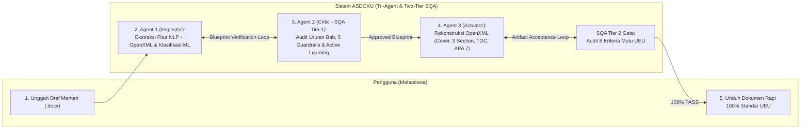

# BUSINESS REQUIREMENTS DOCUMENT (BRD)
## Sistem Otomatisasi Deteksi Struktur dan Formatting Dokumen Akademik Berbasis Multi-Agent System & Natural Language Processing (ASDOKU)

> **Kode Dokumen:** `[ISI DATA: misal BRD-FASILKOM-UEU-2026-001]`  
> **Judul Tugas Akhir:** Rancang Bangun Multi-Agent System untuk Otomatisasi Deteksi Struktur dan Formatting Dokumen Akademik Berbasis Natural Language Processing  
> **Unit Kerja / Institusi:** Fakultas Ilmu Komputer (FASILKOM) — Universitas Esa Unggul  
> **Regulasi Acuan:** SK Rektor Universitas Esa Unggul No. `[ISI DATA]` Tahun `[ISI DATA]` (Pedoman Penulisan Skripsi & Tugas Akhir)  
> **Tanggal Penyusunan:** `[ISI DATA]`  
> **Versi Dokumen:** `[ISI DATA]`  
> **Penyusun:** `[ISI DATA: Nama & NIM Mahasiswa]`

---

## 1. Executive Summary

### 1.1. Latar Belakang Bisnis (Akademik)
Penulisan karya ilmiah akhir (Skripsi, Proposal Tugas Akhir, dan Laporan Kerja Praktik/MBKM) merupakan syarat kelulusan wajib bagi mahasiswa Fakultas Ilmu Komputer Universitas Esa Unggul (UEU). Dalam pelaksanaannya, setiap naskah akademik wajib mematuhi standar tata letak dan tipografi baku yang ditetapkan dalam Surat Keputusan (SK) Rektor Universitas Esa Unggul Nomor `[ISI DATA]` Tahun `[ISI DATA]`. Standar ini mengatur secara ketat struktur pembagian halaman (*section*), hierarki penomoran bab dan sub-bab, margin kertas, jenis dan ukuran huruf, penomoran halaman ganda (*Romawi* dan *Latin*), format tabel berstandar *APA 7th Edition*, hingga penyusunan Daftar Isi otomatis.

### 1.2. Masalah Nyata (*Pain Points*)
Dalam proses bimbingan dan verifikasi naskah akademik saat ini, ditemukan empat permasalahan operasional utama yang menghambat efisiensi akademik:
1. **Inkonsistensi Tipografi dan Tata Letak:** Mahasiswa sering menyalin teks dari berbagai referensi eksternal sehingga menghasilkan jenis huruf, spasi antarbaris, dan batas margin yang tidak seragam.
2. **Kerusakan Struktur Penomoran Manual:** Penomoran sub-bab, *caption* gambar/tabel, serta pemisahan nomor halaman bagian awal (*frontmatter*) dan batang tubuh (*body*) masih dilakukan secara manual, sehingga rentan rusak ketika terjadi revisi konten.
3. **Ketiadaan Hierarki *Heading* Resmi:** Mayoritas mahasiswa hanya menerapkan format cetak tebal (*bold*) secara manual tanpa menggunakan fitur *Styles Heading* bawaan pengolah kata. Akibatnya, *Navigation Pane* menjadi kosong dan penyusunan Daftar Isi dilakukan secara manual dengan risiko ketidakcocokan nomor halaman yang tinggi.
4. **Ketidakpatuhan Format Tabel & Beban Administrasi Dosen:** Banyak tabel masih memuat garis vertikal yang melanggar kaidah APA 7. Dosen pembimbing dan koordinator Tugas Akhir harus menghabiskan waktu `[ISI DATA]` menit/jam per dokumen hanya untuk mengoreksi kesalahan teknis tata letak alih-alih berfokus pada substansi ilmiah penelitian.

### 1.3. Tujuan Sistem (Solusi yang Diusulkan)
Proyek **ASDOKU (Asisten Dokumen Akademik UEU)** bertujuan membangun sistem otomatisasi berbasis web yang mengintegrasikan **Natural Language Processing (NLP)** dan arsitektur **Multi-Agent System (MAS)** (*Inspector Agent*, *Quality Critic Agent*, dan *Formatting Actuator Agent*). Sistem ini dirancang untuk mendeteksi struktur logis naskah mentah berformat `.docx`, memvalidasi urutan hierarki dokumen melalui mekanisme **Two-Tier Software Quality Assurance (SQA)**, serta merekonstruksi tata letak dokumen secara non-destruktif melalui manipulasi tingkat rendah *OpenXML* agar patuh terhadap pedoman penulisan UEU dalam waktu singkat.

---

## 2. Business Objectives & Success Metrics

Sasaran bisnis dan akademik dari implementasi sistem ASDOKU dirumuskan menggunakan prinsip **SMART** (*Specific, Measurable, Achievable, Relevant, Time-bound*) sebagai berikut:

| ID | Kategori Objektif | Deskripsi Sasaran Bisnis (SMART) | Indikator Keberhasilan (*Success Metrics*) | Target Capaian |
| :--- | :--- | :--- | :--- | :--- |
| **BO-01** | **Akurasi Deteksi Struktur (NLP)** | Mencapai tingkat ketepatan klasifikasi struktur paragraf (Judul Bab, Sub-bab, Paragraf Isi, Tabel, Gambar, Formula, *Frontmatter*) menggunakan ekstraksi fitur hibrida NLP (*TF-IDF*) dan metadata *OpenXML*. | *Accuracy*, *Macro F1-Score*, dan *Weighted F1-Score* pada evaluasi model *Machine Learning*. | Akurasi $\ge$ `[ISI DATA]`%  Macro F1 $\ge$ `[ISI DATA]`  Weighted F1 $\ge$ `[ISI DATA]` |
| **BO-02** | **Kepatuhan Mutu Regulasi (SQA)** | Menjamin bahwa seluruh dokumen `.docx` hasil pemformatan otomatis memenuhi 8 kriteria mutu tata letak SK Rektor UEU dan standar tabel APA 7 tanpa merusak isi teks asli penulis. | Persentase skor kelulusan audit pada *SQA Tier 2 Artifact Acceptance Gate* terhadap `[ISI DATA]` dokumen uji emas (*Gold Datasets*). | `[ISI DATA]`% PASS |
| **BO-03** | **Efisiensi Waktu Pemrosesan** | Memangkas durasi perbaikan tata letak dokumen akademik dari pengerjaan manual berjam-jam menjadi pemrosesan otomatis instan melalui antarmuka web. | Rata-rata waktu eksekusi *end-to-end* (*processing latency*) dari saat dokumen diunggah hingga siap diunduh. | $\le$ `[ISI DATA]` detik per dokumen |
| **BO-04** | **Adaptabilitas Sistem (*Active Learning*)** | Meningkatkan kemampuan generalisasi model terhadap variasi naskah akademik baru (seperti Laporan Magang/MBKM) melalui penyimpanan koreksi otomatis dari *Quality Critic Agent*. | Jumlah sampel anomali yang berhasil dikoreksi pada *SQA Tier 1* dan diintegrasikan ke dalam siklus *Continuous Retraining* setelah mencapai ambang batas `[ISI DATA]` data baru. | Penurunan *error* deteksi sebesar `[ISI DATA]`% pasca-*retraining* |

---

## 3. Scope (Ruang Lingkup Proyek)

### 3.1. In-Scope (Dalam Ruang Lingkup)
1. **Pemrosesan Berkas Masukan:** Penerimaan dan pembacaan dokumen akademik mentah dalam format *Microsoft Word OpenXML* (`.docx`).
2. **Ekstraksi Fitur Hibrida (NLP & OpenXML):** Ekstraksi `[ISI DATA]` fitur teks *TF-IDF N-Gram* dan `[ISI DATA]` fitur metadata struktural *OpenXML* (`char_len`, `font_size`, `is_bold`, `has_num`, `doc_pos`, dll.) pada 7 pilar dataset akademik.
3. **Arsitektur Tri-Agent System:**
   * **Agent 1 (Inspector):** Klasifikasi probabilistik paragraf berbasis *Machine Learning* (*Random Forest* vs *Logistic Regression*) dan penandaan ambiguitas (*confidence threshold* $<$ `[ISI DATA]`).
   * **Agent 2 (Quality Critic & SQA Coordinator):** Validasi urutan bab monotonik, *5 Lapisan Guardrail* (termasuk isolasi zona sub-bab Sistematika Penulisan dan deteksi bab Laporan Magang), serta pengawasan mutu *Two-Tier SQA*.
   * **Agent 3 (Formatting Actuator):** Manipulasi *low-level OpenXML* untuk merekonstruksi sampul resmi UEU, pembagian 3 *Section* terisolasi, *Dual Page Numbering* (Romawi & Latin), penyuntikan *Heading 1–3* ke *Navigation Pane*, *Dynamic Table of Contents (TOC)*, dan pemformatan tabel *APA 7th Edition*.
4. **Mekanisme Active Learning:** Pencatatan otomatis hasil koreksi *Agent 2* ke dalam repositori umpan balik (`.csv`) dan pemicuan *retraining* serta *hot-reload* model secara otomatis.
5. **Aplikasi Web Multi-Halaman (FastAPI MPA):** Penyediaan antarmuka web yang mencakup studio unggah/unduh dokumen interaktif, konsol log eksekusi *real-time*, kartu skor SQA, serta halaman dokumentasi metodologi dan visualisasi *pipeline*.

### 3.2. Out-of-Scope (Di Luar Ruang Lingkup)
1. **Format Berkas Non-OpenXML:** Sistem tidak memproses dokumen masukan berformat `.pdf`, `.doc` (Word 97–2003 biner), `.odt`, atau `.tex` (LaTeX) secara langsung tanpa konversi terlebih dahulu ke `.docx`.
2. **Pemeriksaan Substansi & Tata Bahasa (Grammar/Typo):** Sistem tidak melakukan pengubahan isi kalimat ilmiah mahasiswa, tidak memeriksa kesalahan ejaan bahasa (PUEBI/EYD), dan tidak melakukan parafrase konten.
3. **Deteksi Plagiarisme & Manajemen Sitasi Eksternal:** Sistem tidak memeriksa persentase kemiripan naskah (*similarity check* seperti Turnitin) dan tidak terhubung langsung dengan basis data manajer referensi eksternal (Mendeley/Zotero) untuk memvalidasi kebenaran metadata sumber pustaka.
4. **Integrasi Sistem Informasi Akademik Kampus (SIAKAD):** Sistem berjalan sebagai platform mandiri (*standalone web application*) dan belum terintegrasi langsung dengan portal SIAKAD atau sistem administrasi pendaftaran sidang UEU.

---

## 4. Stakeholder Analysis

Berikut adalah pemetaan pemangku kepentingan (*stakeholders*) yang terlibat secara langsung maupun tidak langsung dalam siklus hidup sistem ASDOKU:

| Stakeholder | Peran dalam Sistem / Proyek | Kepentingan Utama (*Interest*) | Tingkat Pengaruh (*Influence*) |
| :--- | :--- | :--- | :--- |
| **Mahasiswa FASILKOM UEU** | Pengguna Akhir Utama (*Primary End-User*) | Mendapatkan hasil pemformatan dokumen Skripsi, Proposal, atau Laporan Magang yang rapi dan 100% sesuai pedoman kampus secara instan tanpa mengatur tata letak Word secara manual. | **Tinggi** (Penentu adopsi dan kepuasan pengguna sistem) |
| **Dosen Pembimbing & Penguji** | Penerima Manfaat Akademik (*Indirect Beneficiary / Reviewer*) | Menerima draf naskah bimbingan yang sudah rapi secara struktural dan tipografis sehingga dapat berfokus penuh pada evaluasi substansi keilmuan mahasiswa. | **Tinggi** (Pemberi validasi kelayakan format naskah bimbingan) |
| **Koordinator TA / Pihak Fakultas (FASILKOM UEU)** | Pemilik Regulasi (*Policy Owner / Standard Regulator*) | Memastikan keseragaman standar lulusan dan kepatuhan seluruh karya ilmiah mahasiswa terhadap SK Rektor UEU Nomor `[ISI DATA]` Tahun `[ISI DATA]`. | **Tinggi** (Penentu aturan baku mutu tata letak dokumen) |
| **Peneliti / Pengembang Sistem (Tim Riset Asdoku)** | Arsitek Sistem, *ML Engineer*, & *Software Developer* | Merancang, membangun, melatih model NLP/ML, menguji arsitektur *Tri-Agent System*, serta memastikan seluruh metrik evaluasi Tugas Akhir tercapai. | **Sangat Tinggi** (Pelaksana teknis penuh pembangunan sistem) |

---

## 5. Functional Requirements (Kebutuhan Fungsional)

Tabel berikut merinci kebutuhan fungsional (*Functional Requirements*) sistem ASDOKU yang dipetakan ke dalam modul antarmuka web, ketiga agen cerdas, serta modul pembelajaran aktif:

| ID | Modul / Komponen | Deskripsi Kebutuhan Fungsional | Prioritas |
| :--- | :--- | :--- | :--- |
| **FR-01** | **Web Interface (`app.py`)** | Sistem harus menyediakan fitur *drag-and-drop* atau pemilihan berkas bagi pengguna untuk mengunggah dokumen mentah berekstensi `.docx`. | Wajib (*Must Have*) |
| **FR-02** | **Agent 1: Inspector** | Sistem harus mampu membaca struktur dokumen `.docx` secara non-destruktif dan mengekstraksi fitur hibrida yang terdiri dari `[ISI DATA]` dimensi *TF-IDF N-Gram* dan `[ISI DATA]` fitur metadata *OpenXML* pada setiap paragraf. | Wajib (*Must Have*) |
| **FR-03** | **Agent 1: Inspector** | Sistem harus mampu mengklasifikasikan setiap paragraf ke dalam label struktur dokumen menggunakan model *Machine Learning* terlatih dan menghasilkan *Draft Blueprint* beserta skor keyakinan (*confidence score*). | Wajib (*Must Have*) |
| **FR-04** | **Agent 1: Inspector** | Sistem harus menandai paragraf dengan status `is_ambiguous = True` apabila skor keyakinan prediksi model berada di bawah ambang batas `[ISI DATA]`. | Wajib (*Must Have*) |
| **FR-05** | **Agent 2: Quality Critic (SQA Tier 1)** | Sistem harus melakukan audit urutan bab secara monotonik ($\text{Bab I} \rightarrow \text{Bab II} \rightarrow \text{Bab III} \dots$) serta mengenali judul bab kanonikal maupun pola *Regex* `^BAB\s+([IVX\d]+)` pada dokumen Skripsi dan Laporan Magang. | Wajib (*Must Have*) |
| **FR-06** | **Agent 2: Quality Critic (SQA Tier 1)** | Sistem harus mengimplementasikan *Guardrail* karantina halaman awal (*frontmatter*) dan isolasi zona sub-bab Sistematika Penulisan agar rincian penjelasan bab tidak memicu pembuatan bab baru palsu (*false positive*). | Wajib (*Must Have*) |
| **FR-07** | **Agent 2: Quality Critic (SQA Tier 1)** | Sistem harus memvalidasi dan mengamankan baris rumus/persamaan matematika serta format *caption* Gambar dan Tabel agar tidak salah terklasifikasi menjadi sub-bab. | Wajib (*Must Have*) |
| **FR-08** | **Agent 1 & Agent 2 Coordination** | Sistem harus menjalankan siklus negosiasi *SQA Tier 1* (*Feedback Directives* dan re-inspeksi adaptif) hingga menghasilkan *Approved Blueprint* yang 100% konsisten secara struktural. | Wajib (*Must Have*) |
| **FR-09** | **Agent 3: Formatting Actuator** | Sistem harus melakukan sanitasi total terhadap properti bawaan *template* yang cacat (seperti menghapus tag `<w:numPr>` liar) dan merekonstruksi halaman Sampul (*Cover*) resmi lengkap dengan logo UEU berukuran `[ISI DATA]` cm di posisi tengah. | Wajib (*Must Have*) |
| **FR-10** | **Agent 3: Formatting Actuator** | Sistem harus membagi dokumen menjadi 3 seksi terisolasi (*Section 0: Cover*, *Section 1: Frontmatter*, *Section 2: Isi Bab*) dengan pengaturan `link_to_previous = False` untuk menerapkan *Dual Page Numbering* (Romawi kecil di *Frontmatter* dan angka Latin di Bab Isi). | Wajib (*Must Have*) |
| **FR-11** | **Agent 3: Formatting Actuator** | Sistem harus menyuntikkan properti *style* resmi dan tag `<w:outlineLvl>` untuk *Heading 1*, *Heading 2*, dan *Heading 3* agar struktur bab langsung muncul pada *Navigation Pane* Microsoft Word. | Wajib (*Must Have*) |
| **FR-12** | **Agent 3: Formatting Actuator** | Sistem harus menghasilkan *Dynamic Table of Contents* (Daftar Isi, Daftar Gambar, Daftar Tabel) menggunakan *field* dinamis Word dengan *dot leaders* rapi dan mengaktifkan fitur `<w:updateFields w:val="true"/>`. | Wajib (*Must Have*) |
| **FR-13** | **Agent 3: Formatting Actuator** | Sistem harus menstandarisasi seluruh tabel di dalam dokumen menjadi format *APA 7th Edition* (menghapus seluruh garis batas vertikal dan hanya menyisakan garis horizontal atas, pemisah *header*, dan penutup bawah) serta menyeragamkan tipografi *Times New Roman* sesuai ukuran baku. | Wajib (*Must Have*) |
| **FR-14** | **Agent 2: Quality Critic (SQA Tier 2)** | Sistem harus mengaudit berkas fisik `.docx` hasil rekonstruksi *Agent 3* terhadap `[ISI DATA]` kriteria mutu SK Rektor UEU (margin `[ISI DATA]` cm, ukuran kertas A4, *header* "Universitas Esa Unggul" kanan atas, spasi baris `[ISI DATA]`, dll.) dan menginstruksikan auto-remediasi jika ditemukan cacat. | Wajib (*Must Have*) |
| **FR-15** | **Active Learning Module** | Sistem harus menyimpan setiap koreksi label yang dilakukan oleh *Agent 2* terhadap prediksi awal *Agent 1* ke dalam berkas umpan balik CSV, lalu memicu *continuous retraining* dan *hot-reload* model secara otomatis ketika jumlah data baru mencapai $\ge$ `[ISI DATA]` sampel. | Tinggi (*Should Have*) |
| **FR-16** | **Web Interface (`alat.html` & `alat.js`)** | Sistem harus menampilkan progres pemrosesan interaktif, konsol log eksekusi agen secara *real-time*, kartu skor kepatuhan SQA, serta tombol unduh berkas hasil berawalan `(Asdoku) - ...`. | Wajib (*Must Have*) |

---

## 6. Non-Functional Requirements (Kebutuhan Non-Fungsional)

| Kategori NFR | ID | Spesifikasi Kebutuhan Non-Fungsional | Parameter Target |
| :--- | :--- | :--- | :--- |
| **Performance (Kinerja & Kecepatan)** | **NFR-01** | Waktu inferensi model *Machine Learning* pada *Agent 1* untuk mengklasifikasikan ratusan paragraf harus berlangsung sangat cepat tanpa memerlukan akselerator GPU khusus. | $\le$ `[ISI DATA]` detik |
| **Performance (Kinerja & Kecepatan)** | **NFR-02** | Total waktu pemrosesan dokumen secara menyeluruh (*end-to-end pipeline* dari *Agent 1* hingga lulus *SQA Tier 2* di *Agent 3*) untuk naskah berukuran standar (`[ISI DATA]`–`[ISI DATA]` paragraf). | $\le$ `[ISI DATA]` detik |
| **Reliability & Integrity (Keandalan)** | **NFR-03** | **Prinsip Non-Destruktif Mutlak:** Sistem dilarang keras menghapus, memotong, atau mengubah substansi kalimat, gambar, maupun data di dalam sel tabel milik pengguna selama proses rekonstruksi *OpenXML*. | 100% Preservasi Konten Asli |
| **Reliability & Integrity (Keandalan)** | **NFR-04** | Pembaruan model melalui mekanisme *Active Learning* harus menggunakan teknik *hot-reload* di memori tanpa menyebabkan *downtime* atau menghentikan layanan *web server* FastAPI. | 0 detik *Downtime* saat *Reload* |
| **Usability (Kemudahan Penggunaan)** | **NFR-05** | Antarmuka web harus dirancang dengan tema visual yang bersih dan intuitif (*Warm Minimalist / Notion Style*), sehingga pengguna awam dapat memformat dokumen maksimal dalam `[ISI DATA]` langkah klik (Unggah $\rightarrow$ Proses $\rightarrow$ Unduh). | Maksimal `[ISI DATA]` interaksi klik utama |
| **Compatibility (Kompatibilitas)** | **NFR-06** | Berkas `.docx` keluaran sistem harus kompatibel penuh dan menampilkan *Navigation Pane* serta pembaruan halaman otomatis saat dibuka pada perangkat lunak Microsoft Word versi `[ISI DATA]` ke atas. | Kompatibilitas Standar ECMA-376 / ISO/IEC 29500 (OpenXML) |
| **Security & Privacy (Keamanan)** | **NFR-07** | Seluruh proses ekstraksi fitur NLP dan rekonstruksi dokumen dilakukan secara lokal di dalam *server* aplikasi tanpa mengirimkan isi naskah belum terpublikasi milik mahasiswa ke layanan API pihak ketiga eksternal. | 100% Pemrosesan Lokal (*On-Premise / Local Server*) |

---

## 7. Business Process: As-Is vs To-Be

### 7.1. Proses Bisnis Saat Ini (*As-Is Process* — Pemformatan Manual)
Pada alur konvensional tanpa sistem ASDOKU, mahasiswa dan dosen melalui tahapan yang panjang dan berulang:
1. Mahasiswa menulis draf naskah di Microsoft Word dengan menyalin materi dari berbagai sumber tanpa mengatur *Styles* atau *Section Break*.
2. Mahasiswa mengatur jenis font, ukuran huruf, spasi, dan margin secara manual blok demi blok.
3. Mahasiswa membuat nomor halaman Romawi dan angka Latin dengan cara memisahkan dokumen menjadi beberapa *file* terpisah karena kesulitan mengatur *Section Break* dan memutus *Link to Previous*.
4. Mahasiswa mengetik Daftar Isi, Daftar Gambar, dan Daftar Tabel secara manual beserta titik-titik (*dot leaders*) dan nomor halamannya.
5. Mahasiswa menyerahkan draf ke Dosen Pembimbing; Dosen menemukan banyak kesalahan format (tabel bergaris vertikal, margin salah, nomor sub-bab lompat) dan mengembalikan naskah untuk direvisi.
6. Saat mahasiswa menambah atau menghapus paragraf, seluruh nomor halaman bergeser dan penomoran manual rusak, memaksa mahasiswa mengulangi langkah 2–4 dari awal (memakan waktu `[ISI DATA]` jam/hari).

### 7.2. Proses Bisnis Baru (*To-Be Process* — Otomatisasi Multi-Agent ASDOKU)
Dengan implementasi sistem ASDOKU, alur proses diringkas menjadi tahapan otomatis berkecepatan tinggi:

### 7.3. Ringkasan Perbandingan As-Is vs To-Be

| Dimensi Perbandingan | Kondisi Saat Ini (*As-Is* Manual) | Kondisi Usulan (*To-Be* Sistem ASDOKU) |
| :--- | :--- | :--- |
| **Durasi Pengerjaan Format** | `[ISI DATA]` jam hingga berhari-hari per dokumen. | $\le$ `[ISI DATA]` detik per dokumen secara otomatis. |
| **Pengaturan Section & Nomor Halaman** | Sering dipisah menjadi beberapa file Word berbeda karena gagal mengatur Romawi vs Latin. | Otomatis terbagi menjadi 3 Section terisolasi dalam 1 berkas `.docx` utuh. |
| **Daftar Isi & Navigation Pane** | Diketik manual; *Navigation Pane* kosong karena tidak memakai *Heading Styles*. | Disuntikkan tag `<w:outlineLvl>` dan *Dynamic TOC Field* yang sinkron otomatis. |
| **Standarisasi Tabel (APA 7)** | Mengedit garis batas (*borders*) satu per satu pada setiap tabel. | Seluruh tabel dirombak otomatis ke format APA 7 tanpa garis vertikal. |
| **Penjaminan Mutu (*Quality Control*)** | Diperiksa manual secara kasatmata oleh mahasiswa dan dosen pembimbing. | Diaudit secara algoritmik melalui arsitektur *Two-Tier SQA* terhadap 8 kriteria mutu UEU. |

---

## 8. Assumptions & Constraints

### 8.1. Asumsi (*Assumptions*)
1. Pengguna mengunggah dokumen akademik dalam format `.docx` yang tidak terkunci kata sandi (*password-protected*) atau terenkripsi DRM.
2. Struktur penulisan naskah akademik mengikuti kaidah bahasa Indonesia untuk karya ilmiah di lingkungan Universitas Esa Unggul (memiliki unsur bagian awal, batang tubuh bab pembahasan, dan bagian akhir).
3. Pengguna memiliki perangkat lunak pengolah kata (seperti Microsoft Word) untuk membuka berkas hasil dan menyetujui pembaruan *field* Daftar Isi otomatis saat dokumen pertama kali dibuka.
4. Lingkungan server tempat aplikasi dijalankan memiliki instalasi *runtime* Python beserta pustaka dependensi (`FastAPI`, `scikit-learn`, `python-docx`, `lxml`, `joblib`) yang telah terkonfigurasi.

### 8.2. Batasan Sistem (*Constraints*)
- **Batasan Regulasi:** Aturan tata letak, ukuran huruf, spasi, dan margin pada Agent 3 dikodekan secara spesifik mengacu pada SK Rektor Universitas Esa Unggul Nomor `[ISI DATA]` Tahun `[ISI DATA]` serta pedoman tabel APA 7th Edition.
- **Batasan Teknis Page Rendering:** Karena manipulasi dilakukan langsung pada tingkat struktur XML (`.docx`) tanpa membuka antarmuka grafis Microsoft Word (*headless XML manipulation*), perhitungan nomor halaman aktual pada Daftar Isi diserahkan pada mesin *layout rendering* Word melalui instruksi `<w:updateFields w:val="true"/>`.
- **Batasan Dataset Pelatihan:** Kemampuan klasifikasi awal Agent 1 bergantung pada cakupan distribusi data pada `[ISI DATA]` sampel di dalam 7 pilar dataset akademik UEU sebelum diperkaya lebih lanjut oleh siklus *Active Learning*.

---

## 9. Risk Register (Daftar Risiko & Mitigasi)

Berikut adalah analisis risiko teknis dan operasional selama pengembangan maupun pengoperasian sistem ASDOKU beserta strategi mitigasinya:

| ID | Deskripsi Risiko | Probabilitas | Dampak | Strategi Mitigasi (Solusi Arsitektural) |
| :--- | :--- | :---: | :---: | :--- |
| **RSK-01** | **False Positive Pergantian Bab pada Sub-bab 1.7 (Sistematika Penulisan):** Penjelasan rincian "Bab I, Bab II, Bab III" di dalam sub-bab 1.7 terdeteksi sebagai judul bab baru sehingga merusak urutan bab dokumen. | Tinggi | Tinggi | Menerapkan Isolasi Zona Sistematika Penulisan dan *Guardrail* pada Agent 2 yang menolak pembuatan bab baru jika paragraf ber-*style* Heading 2, diawali nomor 1.x, memuat lebih dari satu bab dalam satu baris, atau mengandung kata kerja naratif (membahas, berisi, menjelaskan). |
| **RSK-02** | **False Negative Judul Bab pada Dokumen Non-Skripsi (Laporan Magang/MBKM):** Nama bab seperti `BAB 3 PROFIL PERUSAHAAN` atau `BAB 4 RISET DAN PEMBAHASAN` tidak dikenali sebagai Heading 1 karena tidak ada di kamus skripsi standar, menyebabkan penomoran sub-bab membengkak (misal hingga 2.26). | Tinggi | Tinggi | Menerapkan *Regex Priority Pattern* (`^BAB\s+([IVX\d]+)`) dan aturan Preservasi Style Word pada Agent 2 sehingga setiap baris yang diawali pola kata "BAB" dan angka/Romawi langsung dikunci sebagai `JUDUL_BAB` (Heading 1) tanpa terhalang kamus kata statis. |
| **RSK-03** | **Penomoran Ganda (*Double Numbering*) Akibat Bawaan Template Kotor:** Paragraf sub-bab pada dokumen mentah sudah memiliki *auto-numbering* XML bawaan (`<w:numPr>`) sehingga ketika diformat ulang menghasilkan nomor ganda (misal `1.1 1.1 Latar Belakang`). | Sedang | Tinggi | Menerapkan prosedur Sanitasi Total Template pada Agent 3 yang secara otomatis melucuti seluruh elemen `<w:numPr>` dan mereset indentasi liar sebelum menyuntikkan format penomoran standar UEU. |
| **RSK-04** | **Baris Rumus / Persamaan Matematika Terformat Menjadi Sub-bab:** Notasi rumus atau penomoran persamaan (2.1) salah dikenali oleh model ML sebagai sub-bab Heading 2. | Sedang | Sedang | Menambahkan dataset khusus (Dataset 6: Code & Formulas) pada pelatihan Agent 1 serta menyematkan Filter Persamaan & Formula Matematika pada Agent 2 (*Quality Critic*). |
| **RSK-05** | **Degradasi Performa Model Akibat Data Active Learning yang Bias:** Masuknya sampel umpan balik yang keliru ke dalam *pool* pelatihan ulang dapat menurunkan akurasi model dasar. | Rendah | Sedang | Hanya mengizinkan penyimpanan data *Active Learning* dari hasil koreksi deterministik Agent 2 yang telah lulus validasi SQA Tier 1, serta memisahkan dataset latih murni (`build_pure_training_data.py`). |

---

## 10. Acceptance Criteria (Kriteria Penerimaan Sistem)

Sistem ASDOKU dinyatakan selesai, layak, dan dapat diterima (*Accepted*) untuk kebutuhan pengujian Tugas Akhir apabila memenuhi seluruh kriteria penerimaan berikut:

### 10.1. Kriteria Penerimaan Model NLP & Machine Learning (SQA Tier 1)
- [ ] Pipeline ekstraksi fitur berhasil mengekstraksi `[ISI DATA]` dimensi fitur gabungan (TF-IDF + OpenXML) tanpa kegagalan (*runtime error*).
- [ ] Model utama (Random Forest) mencapai nilai Accuracy minimal `[ISI DATA]`% dan mengungguli model pembanding (Logistic Regression) pada pengujian dataset evaluasi.
- [ ] Agent 2 (*Quality Critic*) berhasil mendeteksi dan memperbaiki 100% anomali urutan bab monotonik, melindungi zona sub-bab 1.7, serta mengenali seluruh bab pada dokumen Skripsi maupun Laporan Magang.

### 10.2. Kriteria Penerimaan Mutu Artifak Dokumen (SQA Tier 2 — 8 Kriteria Mutu UEU)
- [ ] **AC-01 (Margin):** Seluruh seksi dokumen memiliki batas margin Kiri `[ISI DATA]` cm, Atas `[ISI DATA]` cm, Kanan `[ISI DATA]` cm, dan Bawah `[ISI DATA]` cm.
- [ ] **AC-02 (Dual Page Numbering):** Bagian Frontmatter menggunakan angka Romawi kecil (i, ii, iii) di tengah bawah, dan bagian Batang Tubuh (Bab I–V) menggunakan angka Latin (1, 2, 3) mulai dari 1 secara independen.
- [ ] **AC-03 (Heading 1):** Seluruh judul bab berformat Times New Roman `[ISI DATA]` pt, Bold, ALL CAPS, rata tengah mutlak (*Center*) tanpa offset indentasi, dan terdaftar di *Navigation Pane*.
- [ ] **AC-04 (Heading 2 & 3):** Seluruh sub-bab berformat Times New Roman `[ISI DATA]` pt, Bold, rata kiri dengan tab stop `[ISI DATA]` cm, dan terdaftar di *Navigation Pane*.
- [ ] **AC-05 (Spasi & Paragraf):** Seluruh paragraf isi memiliki Spacing Before/After `[ISI DATA]` pt, Line Spacing `[ISI DATA]`, perataan *Justify*, dan indentasi baris pertama `[ISI DATA]` cm.
- [ ] **AC-06 (Ukuran Kertas):** Seluruh halaman menggunakan ukuran kertas standar A4 (`[ISI DATA]` $\times$ `[ISI DATA]` cm) dengan preservasi orientasi *Portrait / Landscape*.
- [ ] **AC-07 (Header Resmi):** Terdapat teks header "Universitas Esa Unggul" di posisi kanan atas pada seluruh halaman kecuali halaman Sampul (*Cover*).
- [ ] **AC-08 (Tabel APA 7):** Seluruh tabel dalam dokumen bebas dari garis batas vertikal dan hanya memiliki 3 garis horizontal utama sesuai standar APA 7th Edition.

### 10.3. Kriteria Penerimaan Pengujian Empiris (Gold Datasets)
- [ ] Seluruh `[ISI DATA]` dokumen uji emas (P1 hingga P5) berhasil diproses hingga tuntas dengan skor kepatuhan SQA Tier 2 = `[ISI DATA]`% (PASS) dan waktu pemrosesan rata-rata di bawah `[ISI DATA]` detik per dokumen.