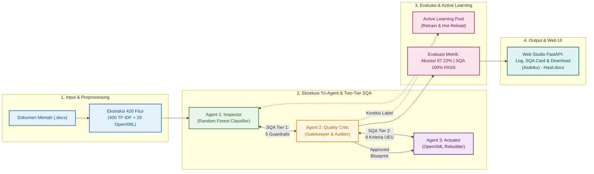

# DOKUMENTASI ARSITEKTUR & FLOWCHART SISTEM ASDOKU
## Otomatisasi Deteksi Struktur & Formatting Dokumen Akademik UEU Berbasis Multi-Agent System (Tri-Agent) & Two-Tier SQA

Dokumen ini memuat arsitektur alur proses lengkap sistem **ASDOKU (Asisten Dokumen Akademik UEU)** dalam dua variasi diagram proses:
1. **Opsi 1: Vertikal Detail (`flowchart TD`)** $\rightarrow$ Dikhususkan untuk **Naskah Skripsi Bab 3 (Metodologi Penelitian)**.
2. **Opsi 2: Horizontal Ringkas (`flowchart LR`)** $\rightarrow$ Dikhususkan untuk **Slide Presentasi (PowerPoint / Canva) Sempro & Sidang Skripsi (Aspek Rasio 16:9)**.

---

## 1. Perbandingan & Rekomendasi Penggunaan: Apakah Cukup 1 Opsi Saja?

> **Rekomendasi Terbaik:** **Gunakan KEDUA OPSI sesuai peruntukan medianya masing-masing.**

| Aspek Perbandingan | Opsi 1: Vertikal Detail (`flowchart TD`) | Opsi 2: Horizontal Ringkas (`flowchart LR`) |
| :--- | :--- | :--- |
| **Tujuan Utama** | Naskah Skripsi Bab 3 (Metodologi Penelitian) & Jurnal Ilmiah. | Slide Presentasi (PowerPoint / Canva) Sempro & Sidang Tugas Akhir. |
| **Format Orientasi** | Vertikal (Top-to-Bottom / Portrait). | Horizontal (Left-to-Right / Landscape 16:9). |
| **Tingkat Kedalaman** | **Sangat Mendalam & Komprehensif:** Menampilkan *decision diamonds*, *fallback loops*, ambiguitas (*confidence threshold* < 0.70), *guardrail* Tier 1, dan remedi XML Tier 2. | **Tinggi (Executive / Arsitektural):** Menampilkan interaksi makro antarentitas agen, alur input-ke-output, dan metrik akhir. |
| **Kelebihan** | Memuaskan dosen penguji yang kritis dan skeptis karena seluruh mekanisme logika agen terpetakan transparan tanpa ada *black-box*. | Muat sempurna dalam satu slide proyektor tanpa font mengecil; sangat mudah dipahami audiens dan dewan penguji dalam durasi presentasi 15 menit. |
| **File Tersedia** | • `flowchart.drawio` • `flowchart.mmd` | • `flowchart_horizontal.drawio` • `flowchart_horizontal.mmd` |

---

## 2. Opsi 1: Alur Proses Lengkap End-to-End (Vertikal — Bab 3 Skripsi)

Diagram ini mengilustrasikan 4 fase kerja sistem:
1. **Input & Preprocessing**: Unggah `.docx`, ekstraksi XML non-destruktif, dan rekayasa 420 fitur hibrida (400 TF-IDF + 20 OpenXML).
2. **Eksekusi Tri-Agent & Two-Tier SQA**:
   - **Agent 1 (Inspector)**: Klasifikasi Random Forest, ambiguitas label (*threshold* < 0.70).
   - **Agent 2 (Quality Critic - SQA Tier 1)**: Validasi monotonik bab & 5 lapisan *guardrail*.
   - **Agent 3 (Formatting Actuator)**: Rekonstruksi XML murni, penataan cover UEU, 3-section numbering, heading XML, dan tabel APA 7.
   - **Agent 2 (Quality Critic - SQA Tier 2)**: Audit fisik file `.docx` terhadap 8 kriteria SK Rektor UEU No. 5 Tahun 2018 dengan *auto-remediation loop*.
3. **Evaluasi Metrik & Active Learning Loop**: Penyimpanan koreksi label ke pool *continuous retraining* (puncak akurasi 97.22%) dan *hot-reload*.
4. **Output Visual & Web Studio**: Tampilan terminal log eksekusi, SQA score card (100% PASS), dan pengunduhan dokumen hasil rekonstruksi.

```mermaid
flowchart TD
    %% ==========================================
    %% DEFINISI STYLING NODE (WARNA AKADEMIK RAPI)
    %% ==========================================
    classDef inputStyle fill:#E3F2FD,stroke:#1565C0,stroke-width:2px,color:#0D47A1
    classDef agent1Style fill:#E8F5E9,stroke:#2E7D32,stroke-width:2px,color:#1B5E20
    classDef agent2Style fill:#FFF8E1,stroke:#F57F17,stroke-width:2px,color:#E65100
    classDef agent3Style fill:#F3E5F5,stroke:#6A1B9A,stroke-width:2px,color:#4A148C
    classDef evalStyle fill:#FCE4EC,stroke:#C2185B,stroke-width:2px,color:#880E4F
    classDef uiStyle fill:#E0F2F1,stroke:#00695C,stroke-width:2px,color:#004D40
    classDef decisionStyle fill:#FFF3E0,stroke:#E65100,stroke-width:2px,color:#BF360C

    %% ==========================================
    %% 1. NODE INPUT DATA & PREPROCESSING
    %% ==========================================
    subgraph S1 ["1. INPUT DATA & PREPROCESSING"]
        direction TB
        Start(["Mulai"]) --> Upload["Unggah Dokumen Mentah (.docx)<br/>via Web Interface FastAPI"]
        Upload --> ParseXML["Non-Destructive XML Parsing<br/>(Ekstraksi Paragraf, Tabel, & Objek)"]
        ParseXML --> FeatEng["Hybrid Feature Engineering (420 Dimensi):<br/>- 400 Fitur NLP (TF-IDF N-Gram 1,2)<br/>- 20 Fitur Metadata OpenXML"]
    end

    %% ==========================================
    %% 2. EKSEKUSI ALGORITMA & PROSES BISNIS UTAMA
    %% ==========================================
    subgraph S2 ["2. EKSEKUSI ALGORITMA TRI-AGENT & TWO-TIER SQA"]
        direction TB
        
        %% AGENT 1: INSPECTOR
        FeatEng --> MLInfer["Agent 1 (Inspector):<br/>Inferensi Model Random Forest (Balanced)<br/>& Hitung Confidence Score"]
        MLInfer --> CheckConf{"Confidence < 0.70?"}
        CheckConf -- "Ya" --> FlagAmb["Tandai Status:<br/>is_ambiguous = True"]
        CheckConf -- "Tidak" --> DraftBP["Terbitkan Draft Blueprint<br/>Struktur Dokumen"]
        FlagAmb --> DraftBP

        %% AGENT 2: CRITIC (SQA TIER 1)
        DraftBP --> AuditT1["Agent 2 (Quality Critic - SQA Tier 1):<br/>Audit Urutan Bab Monotonik &<br/>5 Lapisan Guardrail (Zona 1.7, Magang, Rumus)"]
        AuditT1 --> CheckT1{"Blueprint Konsisten<br/>100%?"}
        CheckT1 -- "Tidak (Ada Anomali)" --> FeedbackDir["Kirim Feedback Directives &<br/>Contextual Re-Inspection ke Agent 1"]
        FeedbackDir --> AuditT1
        CheckT1 -- "Ya (Valid)" --> ApprovedBP["Terbitkan APPROVED BLUEPRINT"]

        %% AGENT 3: ACTUATOR (OPENXML ENGINE)
        ApprovedBP --> SanitizeXML["Agent 3 (Formatting Actuator):<br/>Sanitasi Template & Hapus Tag numPr Liar"]
        SanitizeXML --> RebuildXML["Rekonstruksi Low-Level OpenXML:<br/>1. Cover Resmi UEU & Logo 3 cm<br/>2. 3-Section Division & Dual Page Numbering<br/>3. Injeksi Heading 1-3 (outlineLvl)<br/>4. Dynamic TOC & Tabel Standar APA 7"]
        
        %% SQA TIER 2 GATE
        RebuildXML --> AuditT2["Agent 2 (SQA Tier 2 Quality Gate):<br/>Audit Fisik .docx terhadap 8 Kriteria Mutu<br/>SK Rektor UEU No. 5 Tahun 2018"]
        AuditT2 --> CheckT2{"Skor Kepatuhan<br/>SQA = 100% PASS?"}
        CheckT2 -- "Tidak (Ada Defect)" --> AutoRem["Instruksi Auto-Remediasi<br/>Elemen XML ke Agent 3"]
        AutoRem --> RebuildXML
    end

    %% ==========================================
    %% 3. EVALUASI METRIK & MODEL OUTPUT (ACTIVE LEARNING)
    %% ==========================================
    subgraph S3 ["3. EVALUASI METRIK & ACTIVE LEARNING LOOP"]
        direction TB
        ApprovedBP -. "Jika Ada Koreksi Label Agent 2" .-> SaveAL["Simpan Sampel & 20 Fitur ke<br/>active_learning_feedback.csv"]
        SaveAL --> CheckPool{"Jumlah Feedback<br/>Baru >= 5 Sampel?"}
        CheckPool -- "Ya" --> Retrain["Continuous Retraining Model<br/>& Evaluasi Metrik (Puncak Akurasi 97.22%)"]
        Retrain --> HotReload["Export baseline_model.joblib &<br/>Hot-Reload ke Memori Agent 1"]
        HotReload -. "Update Model" .-> MLInfer
        
        CheckT2 -- "Ya (100% PASS)" --> CalcMetrics["Kompilasi Metrik Eksekusi:<br/>- Waktu Proses (Rata-rata 0.98 Detik)<br/>- Skor SQA Tier 1 & Tier 2 (100% PASS)<br/>- Statistik Struktur Paragraf"]
    end

    %% ==========================================
    %% 4. OUTPUT VISUAL & USER INTERFACE
    %% ==========================================
    subgraph S4 ["4. OUTPUT VISUAL & USER INTERFACE (WEB STUDIO)"]
        direction TB
        CalcMetrics --> RenderUI["Tampilkan Hasil di Web UI (alat.html):<br/>- Live Execution Terminal Log<br/>- SQA Score Card (100% PASS)<br/>- Ringkasan Deteksi Bab & Tabel"]
        RenderUI --> DownloadDoc["Unduh Dokumen Hasil Rekonstruksi:<br/>(Asdoku) - Nama_File.docx"]
        DownloadDoc --> EndNode(["Selesai"])
    end

    %% PENERAPAN CLASS STYLING
    class Upload,ParseXML,FeatEng inputStyle
    class MLInfer,FlagAmb,DraftBP agent1Style
    class AuditT1,FeedbackDir,ApprovedBP,AuditT2,AutoRem agent2Style
    class SanitizeXML,RebuildXML agent3Style
    class SaveAL,Retrain,HotReload,CalcMetrics evalStyle
    class RenderUI,DownloadDoc uiStyle
    class CheckConf,CheckT1,CheckT2,CheckPool decisionStyle
```

---

## 3. Opsi 2: Alur Proses Horizontal Ringkas (Horizontal — Slide Presentasi 16:9)

Diagram ini mengemas interaksi Tri-Agent dan Two-Tier SQA dalam format ringkas berorientasi lanskap (*landscape*), sangat pas disematkan pada 1 slide presentasi tanpa memotong resolusi maupun membuat teks menjadi buram.

---

## 4. Panduan Menggunakan Berkas di Draw.io & Mermaid Live

### A. Membuka Berkas Draw.io (`.drawio`)
Telah disediakan 2 berkas native Draw.io berekstensi `.drawio` yang sudah rapi tertata dengan warna, garis ortogonal, dan grup swimlane:
1. `flowchart.drawio` (Versi Vertikal Detail)
2. `flowchart_horizontal.drawio` (Versi Horizontal Slide)

**Langkah Membuka:**
1. Buka peramban ke **[app.diagrams.net](https://app.diagrams.net/)** atau buka aplikasi **Draw.io Desktop**.
2. Pilih **Open Existing Diagram** (atau menu **File** $\rightarrow$ **Open From** $\rightarrow$ **Device**).
3. Pilih salah satu file `.drawio` di atas.
4. Diagram akan langsung terbuka penuh dalam bentuk objek terpisah yang dapat Anda geser, ubah teksnya, ganti font (misalnya ke *Times New Roman* atau *Arial*), atau sesuaikan warna.
5. Untuk mengekspor: Klik **File** $\rightarrow$ **Export as** $\rightarrow$ **PNG** (centang *Transparent Background*, DPI 300 untuk cetak skripsi berkualitas tinggi) atau **SVG** (format vektor tanpa pecah).

### B. Menggunakan Berkas Mermaid (`.mmd`) di Mermaid Live Editor
1. Buka situs **[mermaid.live](https://mermaid.live/)**.
2. Buka salah satu file:
   - `flowchart.mmd`
   - `flowchart_horizontal.mmd`
3. Salin (*copy*) seluruh teks kode di dalamnya, lalu tempel (*paste*) ke panel kode sebelah kiri Mermaid Live.
4. Di panel bawah, klik tombol **Actions** $\rightarrow$ **Download PNG** atau **Download SVG**.
