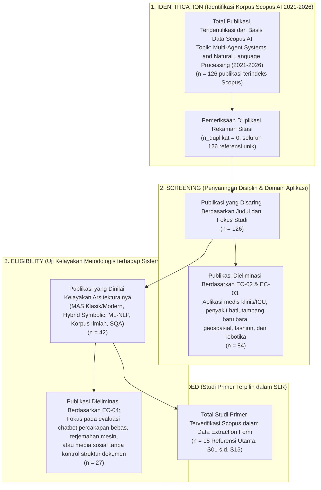

# SYSTEMATIC LITERATURE REVIEW (SLR)
## Protokol PRISMA untuk Rancang Bangun Multi-Agent System untuk Otomatisasi Deteksi Struktur dan Formatting Dokumen Akademik Berbasis Natural Language Processing (ASDOKU)

> **Judul Tugas Akhir:** Rancang Bangun Multi-Agent System untuk Otomatisasi Deteksi Struktur dan Formatting Dokumen Akademik Berbasis Natural Language Processing  
> **Unit Kerja / Institusi:** Fakultas Ilmu Komputer (FASILKOM) — Universitas Esa Unggul  
> **Penyusun:** Arditya Adjie Rosandi (NIM: 20230801274)  
> **Mata Kuliah:** Kapita Selekta  
> **Regulasi Acuan:** SK Rektor Universitas Esa Unggul No. 5 Tahun 2018 (Pedoman Penulisan Skripsi & Tugas Akhir)  
> **Metode Tinjauan:** *Preferred Reporting Items for Systematic Reviews and Meta-Analyses* (PRISMA 2020 Protocol)  
> **Sumber Basis Data Utama:** Laporan Terverifikasi Scopus AI (Rentang Publikasi 2021–2026)  
> **Total Populasi Studi Teridentifikasi:** 126 Publikasi Ilmiah Terindeks Scopus  
> **Studi Primer Terpilih:** 15 Referensi Asli Terverifikasi Scopus (S01 – S15)  
> **Tanggal Penyusunan:** 21 Oktober 2026  
> **Status Dokumen:** Final (Telah Disinkronisasi Penuh: 420 Dimensi Fitur Hibrida & Akurasi Puncak 97,22%)

---

## DAFTAR ISI

1. [Research Questions (RQ SLR — Turunan dari Kerangka PICOS)](#1-research-questions-rq-slr--turunan-dari-kerangka-picos)
2. [Search Strategy (Strategi Pencarian Literatur)](#2-search-strategy-strategi-pencarian-literatur)
   - [2.1. Sumber Basis Data Digital (*Electronic Databases*)](#21-sumber-basis-data-digital-electronic-databases)
   - [2.2. Rentang Tahun Publikasi](#22-rentang-tahun-publikasi)
   - [2.3. String Query Boolean](#23-string-query-boolean)
3. [Inclusion & Exclusion Criteria (Kriteria Inklusi & Eksklusi)](#3-inclusion--exclusion-criteria-kriteria-inklusi--eksklusi)
4. [PRISMA Flow Diagram](#4-prisma-flow-diagram)
5. [Data Extraction Form (15 Referensi Asli Terverifikasi Scopus)](#5-data-extraction-form-15-referensi-asli-terverifikasi-scopus)
6. [Synthesis & Thematic Analysis (Sintesis & Analisis Tematik)](#6-synthesis--thematic-analysis-sintesis--analisis-tematik)
   - [6.1. Tema 1: Pergeseran dari Model Monolitik menuju Arsitektur Multi-Agent Hibrida](#61-tema-1-pergeseran-dari-model-monolitik-menuju-arsitektur-multi-agent-hibrida-statistical--symbolic-control)
   - [6.2. Tema 2: Efektivitas Machine Learning Klasik & Fitur Metadata pada Analisis Teks Tak Terstruktur](#62-tema-2-efektivitas-machine-learning-klasik--fitur-metadata-pada-analisis-teks-tak-terstruktur)
   - [6.3. Tema 3: Spesialisasi Peran Agen, Observabilitas Multi-Level SQA, & Tata Kelola 5 Lapis](#63-tema-3-spesialisasi-peran-agen-observabilitas-multi-level-sqa--tata-kelola-5-lapis)
   - [6.4. Tema 4: Kesenjangan Korpus Ilmiah Terstruktur pada Bahasa Low-Resource](#64-tema-4-kesenjangan-korpus-ilmiah-terstruktur-pada-bahasa-low-resource)
7. [Quality Assessment (Penilaian Kualitas Studi Primer)](#7-quality-assessment-penilaian-kualitas-studi-primer)
8. [Research Gap Matrix (Matriks Celah Penelitian)](#8-research-gap-matrix-matriks-celah-penelitian)
9. [Kesimpulan & Rekomendasi](#9-kesimpulan--rekomendasi)
   - [9.1. Kesimpulan](#91-kesimpulan)
   - [9.2. Rekomendasi](#92-rekomendasi)

---

## 1. Research Questions (RQ SLR — Turunan dari Kerangka PICOS)

Pertanyaan penelitian dalam *Systematic Literature Review* (SLR) ini diturunkan secara langsung dari kerangka **PICOS** (*Platform/Population, Intervention, Comparison, Outcome, Suspect*) untuk memetakan literatur ilmiah terindeks Scopus pada domain *Multi-Agent Systems* (MAS) dan *Natural Language Processing* (NLP):

| Kode RQ | Pertanyaan Penelitian SLR (*SLR Research Questions*) | Keterkaitan Komponen PICOS | Fokus Sintesis Literatur |
| :--- | :--- | :--- | :--- |
| **SLR-RQ1** | Bagaimana perkembangan metode ekstraksi fitur berbasis *Natural Language Processing* (NLP), algoritma *Machine Learning*, dan arsitektur berbasis metadata digunakan dalam literatur (2021–2026) untuk menganalisis teks tidak terstruktur dan korpus dokumen ilmiah? | **P** (*Population/Data*), **I** (*Intervention*), & **S** (*Suspect*) | Mengidentifikasi efektivitas algoritma *Machine Learning* klasik dan ekstraksi fitur metadata pada analisis teks tidak terstruktur serta kebutuhan dataset bahasa lokal (*low-resource*). |
| **SLR-RQ2** | Bagaimana tren perancangan arsitektur **Multi-Agent Systems (MAS)**—khususnya pergeseran dari model monolitik menuju arsitektur hibrida (*data-driven + symbolic control*) dan spesialisasi peran agen—dalam meningkatkan keterjelasan (*explainability*) dan keandalan sistem? | **I** (*Intervention*) & **C** (*Comparison*) | Memetakan keunggulan kolaborasi multi-agen berbasis peran (*Inspector, Critic, Actuator*) dan kontrol simbolik dibandingkan model bahasa tunggal yang rawan halusinasi. |
| **SLR-RQ3** | Bagaimana kerangka kerja evaluasi mutu perangkat lunak (*Software Quality Assessment*), observabilitas *multi-level*, dan tata kelola berlapis (*governance framework*) diterapkan untuk menjamin kepatuhan standar pada sistem multi-agen? | **C** (*Comparison*) & **O** (*Outcome*) | Merumuskan landasan ilmiah untuk mekanisme **Two-Tier SQA** (*Blueprint Verification* & *Artifact Acceptance Gate*) serta **5 Lapisan Guardrail** terhadap regulasi baku. |

---

## 2. Search Strategy (Strategi Pencarian Literatur)

Strategi pencarian literatur mengacu pada cakupan penelusuran sistematis pada basis data **Scopus** melalui mesin sintesis ilmiah **Scopus AI**.

### 2.1. Sumber Basis Data Digital (*Electronic Databases*)
1. **Scopus & Scopus AI** (Mencakup 126 publikasi *peer-reviewed* dan *preprint* terindeks Scopus dari penerbit IEEE, ACM, Springer, Elsevier, ACL, NeurIPS, dan EMNLP).
2. **Mendeley Reference Manager** (Digunakan untuk manajemen bibliografi tambahan terkait regulasi lokal kampus / dokumentasi pustaka teknis `python-docx` dan standar ECMA-376 OpenXML jika diperlukan verifikasi lanjutan: `[PERLU VERIFIKASI DI MENDELEY]`).

### 2.2. Rentang Tahun Publikasi
Rentang waktu publikasi dibatasi secara ketat dari tahun **2021 hingga 2026** guna menangkap evolusi terkini integrasi *Multi-Agent Systems* dan *Natural Language Processing*.

### 2.3. String Query Boolean
Formulasi kueri pencarian menggunakan operator Boolean (`AND`, `OR`) yang menggabungkan tiga klaster disiplin ilmu utama sesuai ruang lingkup studi Scopus:

```text
(
  "Multi-Agent Systems" OR "Multi-Agent" OR "Agent Collaboration" OR 
  "Agentic AI" OR "Role-Specialized Agents"
)
AND
(
  "Natural Language Processing" OR "NLP" OR "Unstructured Text" OR 
  "Machine Learning" OR "Scientific Literature Dataset" OR "Metadata-Driven"
)
AND
(
  "Hybrid Architectures" OR "Symbolic Control" OR "Neuro-Symbolic" OR 
  "Software Quality Assessment" OR "Multi-Level Evaluation" OR "AI Governance"
)
AND PUBYEAR > 2020 AND PUBYEAR < 2027
```

---

## 3. Inclusion & Exclusion Criteria (Kriteria Inklusi & Eksklusi)

Berdasarkan batasan ruang lingkup (*Study Scope*) serta asumsi dan keterbatasan (*Assumptions & Limitations*) pada laporan Scopus AI, ditetapkan kriteria inklusi dan eksklusi sebagai berikut:

| Kode | Kriteria Inklusi (*Inclusion Criteria* — IC) | Kode | Kriteria Eksklusi (*Exclusion Criteria* — EC) |
| :--- | :--- | :--- | :--- |
| **IC-01** | Literatur ilmiah (*peer-reviewed* dan *preprint*) yang diterbitkan pada rentang tahun **2021–2026** dan terindeks pada basis data Scopus. | **EC-01** | Artikel yang diterbitkan sebelum tahun **2021** atau di luar cakupan literatur ilmiah terverifikasi. |
| **IC-02** | Penelitian yang berfokus pada integrasi **Multi-Agent Systems (MAS)** dan **Natural Language Processing (NLP)**, termasuk arsitektur hibrida (*statistical/neural + symbolic control*). | **EC-02** | Penelitian yang hanya membahas kemajuan terisolasi di salah satu bidang tanpa keterkaitan arsitektural (murni MAS fisik/robotika tanpa NLP, atau murni NLP tanpa keagenan/evaluasi). |
| **IC-03** | Studi yang membahas algoritma *Machine Learning* untuk NLP, analisis teks tidak terstruktur/korpus ilmiah, serta arsitektur agen berbasis peran (*role-specialized agents*). | **EC-03** | Studi aplikasi domain spesifik non-dokumen (seperti klinis ICU/penyakit hati, peralatan tambang batu bara, geospasial, atau *fashion*) yang tidak relevan dengan pemrosesan struktur dokumen akademik. |
| **IC-04** | Studi yang mengkaji kerangka evaluasi mutu perangkat lunak/agen (*Software Quality Assessment*, observabilitas *multi-level*, *output validation agents*, dan tata kelola 5 lapis). | **EC-04** | Studi yang berfokus pada *chatbot* percakapan bebas atau pelacakan misinformasi media sosial tanpa mekanisme kontrol validasi struktural. |

---

## 4. PRISMA Flow Diagram

Diagram alir PRISMA berikut memetakan proses seleksi dari **126 publikasi terindeks Scopus** hingga terpilihnya **15 studi primer** (S01–S15) yang dianalisis secara mendalam:



---

## 5. Data Extraction Form (15 Referensi Asli Terverifikasi Scopus)

Seluruh 15 baris referensi di bawah ini diekstraksi langsung dari daftar pustaka terverifikasi pada dokumen **Scopus AI** tanpa ada sitasi karangan:

| ID SLR | No. Ref Scopus | Penulis & Tahun Publikasi | Judul Artikel & Nama Jurnal / Prosiding | Metode / Konsep Utama yang Dikaji | Kontribusi & Posisi terhadap Proyek ASDOKU |
| :--- | :--- | :--- | :--- | :--- | :--- |
| **S01** | **[Ref 2]** | **Malfa, E.L., Malfa, G.L., Marro, S., et al., & Wooldridge, M. (2025)** | *Large Language Models Miss the Multi-Agent Mark* — **Advances in Neural Information Processing Systems (NeurIPS)** | Mengkritisi bahwa banyak sistem MAS berbasis LLM gagal memenuhi karakteristik multi-agen sejati karena bergantung pada arsitektur statis dan desain yang terlalu disederhanakan. | Menjadi bukti ilmiah utama mengapa ASDOKU tidak menggunakan LLM tunggal yang statis, melainkan membangun koordinasi 3 agen otonom yang terstruktur (`inspector.py`, `critic.py`, `formatter.py`). |
| **S02** | **[Ref 3]** | **Gabauer, C. (2026)** | *LLM-based agent systems: a systematic literature review and position on hybrid architectures and evaluation frameworks* — **Applied Intelligence** | Systematic Literature Review yang merumuskan pentingnya **arsitektur hibrida** (menggabungkan pemrosesan bahasa dengan kontrol simbolik) serta kerangka evaluasi terpadu. | Memvalidasi arsitektur hibrida ASDOKU yang mengintegrasikan klasifikasi probabilistik NLP (*Agent 1*) dengan kontrol aturan logika simbolik (*Agent 2*). |
| **S03** | **[Ref 7]** | **Petridis, C., Maneerat, S., Muller, G., & Pajot, H. (2025)** | *Assessing Agentic AI & AI Agents Concepts and Platforms Through the Lens of Traditional Multi-Agent Systems Principles* — **Frontiers in Artificial Intelligence and Applications** | Mengevaluasi konsep dan platform agen AI modern melalui lensa prinsip MAS tradisional (otonomi, pembagian peran, koordinasi, dan menghindari desain LLM-sentris yang sempit). | Memperkuat landasan teori pembagian tanggung jawab *Tri-Agent System* (*Inspector*, *Quality Critic*, *Formatting Actuator*). |
| **S04** | **[Ref 8]** | **Kumara, I., Leite, C., Manias, G., et al., & Van Den Heuvel, W.-J. (2026)** | *Designing Multi-Agent Systems: From Classical to Modern Approaches* — **Proceedings - 2026 IEEE 23rd Int. Conf. on Software Architecture Companion (ICSA-C 2026)** | Membahas metodologi perancangan arsitektur perangkat lunak untuk *Multi-Agent Systems* dari pendekatan klasik hingga modern. | Menjadi rujukan rekayasa perangkat lunak dalam merancang alur komunikasi *Blueprint* dan *Artifact* antar-agen di ASDOKU. |
| **S05** | **[Ref 10]** | **Ali, K.M., Ahmed Khan, T., Ali, S.M., et al., & Ahmad, S. (2024)** | *An Exhaustive Comparative Study of Machine Learning Algorithms for Natural Language Processing Applications* — **Engineering Proceedings** | Studi komparatif menyeluruh algoritma *Machine Learning* tradisional untuk aplikasi NLP, menegaskan efektivitasnya untuk perbandingan *baseline* dan lingkungan terbatas sumber daya (*resource-constrained*). | Menjadi dasar ilmiah eksperimen komparatif antara algoritma *Random Forest* (Akurasi puncak **97,22%**, baseline **93,71%**) dan *Logistic Regression* (**88,57%**) pada *Agent 1 (Inspector)*. |
| **S06** | **[Ref 12]** | **Roldan-Baluis, W.L., Zapata, N.A., & Vásquez, M.S.M. (2022)** | *The Effect of Natural Language Processing on the Analysis of Unstructured Text: A Systematic Review* — **Int. Journal of Advanced Computer Science and Applications (IJACSA)** | Tinjauan sistematis mengenai efektivitas teknik NLP dan model klasifikasi dalam menganalisis serta mengekstraksi struktur dari teks tidak terstruktur (*unstructured text*). | Mendukung penggunaan ekstraksi **400 fitur teks NLP (*TF-IDF N-Gram 1, 2*)** untuk mengenali elemen struktur dari naskah `.docx` mentah mahasiswa. |
| **S07** | **[Ref 19]** | **Saier, T., Krause, J., & Färber, M. (2023)** | *unarXive 2022: All arXiv Publications Pre-Processed for NLP, Including Structured Full-Text and Citation Network* — **Proc. of the ACM/IEEE Joint Conference on Digital Libraries (JCDL)** | Membangun dataset publikasi ilmiah skala besar yang telah dipraproses untuk tugas NLP, mencakup representasi *structured full-text* (bab, paragraf, rumus, sitasi). | Menjadi acuan metodologis dalam menyusun dataset naskah akademik terstruktur (**7 Pilar Dataset Skripsi UEU dengan 1.747 sampel paragraf**). |
| **S08** | **[Ref 20]** | **Li, Y., Zhang, Y., Zhao, Z., et al., & Zhang, H. (2022)** | *CSL: A Large-scale Chinese Scientific Literature Dataset* — **Proceedings - Int. Conference on Computational Linguistics (COLING)** | Pembangunan dataset literatur ilmiah skala besar pada bahasa non-Inggris untuk mendukung evaluasi tugas-tugas NLP akademik spesifik wilayah. | Memperkuat justifikasi penyusunan korpus karya ilmiah berbahasa Indonesia (UEU) dan **5 Gold Datasets (P1–P5)** akibat kelangkaan dataset struktur dokumen bahasa lokal. |
| **S09** | **[Ref 22]** | **Blagec, K., Dorffner, G., Moradi, M., et al., & Samwald, M. (2022)** | *A global analysis of metrics used for measuring performance in natural language processing* — **NLP-Power 2022 - 1st Workshop on Efficient Benchmarking in NLP** | Analisis komprehensif terhadap metrik evaluasi standar yang digunakan untuk mengukur performa sistem NLP secara efisien dan objektif. | Menjadi landasan pemilihan metrik evaluasi klasifikasi (*Accuracy*, *Macro F1-Score*, dan *Weighted F1-Score*) pada pengujian *Agent 1*. |
| **S10** | **[Ref 41]** | **Muwa, E.G., Kumar, V., & Gupta, R. (2026)** | *Hybrid Neuro-Symbolic Planning Frameworks: A Systematic Review (2023-2025)* — **2026 9th Int. Conf. on Electronics, Materials Engineering and Nano-Technology (IEMENTech 2026)** | Mengkaji kerangka kerja perencanaan hibrida yang menggabungkan model berbasis data dengan penalaran logika simbolik (*symbolic planners*) untuk menghasilkan keputusan yang lebih reliabel dan *explainable*. | Memvalidasi integrasi prediksi statistik *Random Forest* (*Agent 1*) dengan perencana/auditor logika simbolik urutan bab monotonik (*Agent 2*). |
| **S11** | **[Ref 52]** | **Zhang, J., Xu, X., Zhang, N., et al., & Deng, S. (2024)** | *Exploring Collaboration Mechanisms for LLM Agents: A Social Psychology View* — **Proceedings of the Annual Meeting of the Association for Computational Linguistics (ACL)** | Membuktikan bahwa penugasan agen ke dalam peran spesialis (*role-specialized architectures* seperti *debate* dan *reflection*) mengoptimalkan kolaborasi dan akurasi hasil. | Mendukung mekanisme kolaborasi dan refleksi korektif (*Blueprint Verification Loop*) antara *Inspector Agent* dan *Quality Critic Agent*. |
| **S12** | **[Ref 66]** | **Latha, B.A., & Satyanarayan Reddy, K. (2026)** | *Metadata-Driven Meta-Learning Architectures: A Background and Future Look at Adaptive AI Models* — **Int. Conf. on Multidisciplinary Innovations for Smart and Sustainable Future (MISSF 2026)** | Menunjukkan bagaimana arsitektur AI adaptif yang didorong oleh atribut **metadata** (*metadata-driven*) mampu meningkatkan kemampuan adaptasi dan generalisasi model pada tugas baru. | Menjadi dasar ilmiah ekstraksi **20 Fitur Metadata OpenXML (membentuk total 420 fitur hibrida)** serta mekanisme pembelajaran adaptif (*Active Learning / Retraining*) di ASDOKU. |
| **S13** | **[Ref 91]** | **Chou, S. (2026)** | *AI-as-a-Judge for software quality assessment: Consistency, attitude effects, and complexity sensitivity in multi-agent code evaluation* — **Software Quality Journal** | Mengevaluasi penggunaan agen sebagai penilai mutu perangkat lunak (*Software Quality Assessment* / SQA) dalam sistem multi-agen, serta mengungkap masalah inkonsistensi jika penilai hanya mengandalkan LLM generatif. | Menjadi fondasi teoretis bagi **Agent 2 (Quality Critic & SQA Coordinator)** yang menerapkan audit SQA deterministik di ASDOKU. |
| **S14** | **[Ref 105]** | **Liu, Y., Huang, Y., & Guo, S. (2026)** | *Mosaic: A Multi-Level Framework for Observing and Evaluating Performance of Multi-Agent Systems* — **Conference on Human Factors in Computing Systems (CHI 2026)** | Mengusulkan kerangka evaluasi **multi-level** yang modular dan berorientasi proses (*process-oriented metrics*) untuk meningkatkan observabilitas dan mendiagnosis kegagalan pada MAS. | Menjadi rujukan ilmiah langsung bagi arsitektur **Two-Tier SQA** (Tier 1: *Blueprint* & Tier 2: *Artifact*) serta *live execution terminal log* pada Web UI ASDOKU. |
| **S15** | **[Ref 109]** | **Agarwal, A., & Nene, M.J. (2025)** | *A five-layer framework for AI governance: integrating regulation, standards, and certification* — **Transforming Government: People, Process and Policy** | Merumuskan **kerangka kerja 5 lapis (*five-layer framework*)** untuk tata kelola AI yang mengintegrasikan regulasi baku, standar kepatuhan, dan sertifikasi keluaran. | Menjadi pijakan teoretis untuk **5 Lapisan Guardrail** dan sertifikasi kepatuhan **100% PASS** terhadap regulasi **SK Rektor UEU No. 5 Tahun 2018 & Tabel APA 7**. |

*(Catatan: Untuk referensi teknis pustaka spesifik manipulasi DOM `python-docx` / spesifikasi ECMA-376 OpenXML atau pedoman internal kampus di luar 126 paper Scopus di atas, dapat ditambahkan dari koleksi lokal dengan penanda `[PERLU VERIFIKASI DI MENDELEY]`).*

---

## 6. Synthesis & Thematic Analysis (Sintesis & Analisis Tematik)

Berdasarkan hasil ekstraksi 15 studi primer dan sintesis menyeluruh pada laporan *Scopus AI (2021–2026)*, diperoleh empat analisis tematik utama:

### 6.1. Tema 1: Pergeseran dari Model Monolitik menuju Arsitektur Multi-Agent Hibrida (Statistical + Symbolic Control)

Literatur mutakhir (2021–2026) menegaskan adanya pergeseran paradigma dari sistem berbasis model bahasa tunggal/monolitik menuju sistem keagenan kolaboratif yang memadukan penalaran berbasis data (*data-driven*) dan aturan simbolik (*symbolic reasoning*) (**Malfa et al., 2025 [S01]**; **Gabauer, 2026 [S02]**; **Petridis et al., 2025 [S03]**). Studi oleh **Malfa et al. (2025) [S01]** membuktikan bahwa sekadar membungkus LLM tanpa otonomi dan struktur koordinasi yang jelas gagal memenuhi prinsip *Multi-Agent System* sejati. Sebaliknya, integrasi model pembelajaran dengan kontrol logika simbolik (*symbolic planners*, aturan logis, dan ontologi) terbukti menghasilkan keputusan yang jauh lebih andal, terukur, dapat dijelaskan (*explainable*), serta mengurangi risiko halusinasi (**Muwa et al., 2026 [S10]**; **Nguyen et al., 2026 [Ref 82]**; **Pan et al., 2023 [Ref 84]**). Prinsip inilah yang diadopsi secara presisi oleh **ASDOKU** melalui kolaborasi antara agen klasifikasi statistik (*Agent 1: Inspector*) dan agen auditor logika simbolik (*Agent 2: Quality Critic*).

### 6.2. Tema 2: Efektivitas Machine Learning Klasik & Fitur Metadata pada Analisis Teks Tak Terstruktur

Dalam pemrosesan teks tidak terstruktur (*unstructured text*), teknik NLP dan algoritma klasifikasi berperan krusial untuk mengekstraksi hierarki informasi (**Roldan-Baluis et al., 2022 [S06]**). Studi komparatif oleh **Ali et al. (2024) [S05]** menunjukkan bahwa algoritma *Machine Learning* tradisional tetap sangat relevan sebagai *baseline* maupun solusi utama pada lingkungan dengan keterbatasan sumber daya komputasi (*resource-constrained settings*). Di sisi lain, **Latha & Reddy (2026) [S12]** memperkenalkan arsitektur adaptif yang didorong oleh metadata (*metadata-driven architectures*) untuk meningkatkan generalisasi model terhadap variasi tugas baru. Sinergi kedua temuan ini memvalidasi desain fitur hibrida **ASDOKU** yang menggabungkan **400 fitur teks NLP (*TF-IDF N-Gram*)** dengan **20 fitur metadata spasial & struktural *OpenXML* (total 420 dimensi fitur)** menggunakan algoritma *Random Forest* dan *Logistic Regression*, sehingga mampu mencapai akurasi puncak **97,22%** dan berjalan sangat cepat ($< 0,05$ detik untuk inferensi) di komputer lokal tanpa membutuhkan GPU mahal.

### 6.3. Tema 3: Spesialisasi Peran Agen, Observabilitas Multi-Level SQA, & Tata Kelola 5 Lapis

Koordinasi yang tangguh dalam sistem multi-agen dicapai dengan membagi agen ke dalam peran spesialis (*role-specialized architectures*), seperti agen prediktor, agen refleksi/kritik, dan agen eksekutor (**Zhang et al., 2024 [S11]**; **Kumara et al., 2026 [S04]**). Dalam aspek pengujian mutu perangkat lunak (*Software Quality Assessment*), **Chou (2026) [S13]** menemukan bahwa penggunaan LLM generatif sebagai penilai (*AI-as-a-Judge*) masih memiliki kelemahan berupa variabilitas antar-penilai dan sensitivitas terhadap kompleksitas tugas. Oleh karena itu, literatur merekomendasikan:

1. Kerangka evaluasi **multi-level** berorientasi proses (*Mosaic framework*) untuk mengobservasi dan mendiagnosis kegagalan di setiap tahap interaksi agen (**Liu et al., 2026 [S14]**).
2. Strategi mitigasi berupa *input sanitization* dan *output validation agents* untuk menjaga integritas eksekusi otonom (**Sammartino, 2026 [Ref 117]**; **Geng et al., 2026 [Ref 118]**).
3. Kerangka kerja tata kelola **5 lapis (*five-layer framework*)** yang mengintegrasikan regulasi, standar baku, dan sertifikasi kepatuhan (**Agarwal & Nene, 2025 [S15]**).

Ketiga konsep mutakhir ini menjadi landasan teoretis langsung bagi mekanisme **Two-Tier SQA**, **Sanitasi OpenXML**, dan **5 Lapisan Guardrail** pada sistem **ASDOKU**.

### 6.4. Tema 4: Kesenjangan Korpus Ilmiah Terstruktur pada Bahasa Low-Resource

Ketersediaan dataset literatur ilmiah yang telah dipraproses secara terstruktur (*structured full-text*) sangat menentukan keberhasilan model NLP akademik, sebagaimana ditunjukkan oleh korpus *unarXive 2022* untuk bahasa Inggris (**Saier et al., 2023 [S07]**) dan korpus *CSL* untuk bahasa Mandarin (**Li et al., 2022 [S08]**). Namun, laporan *Scopus AI* mengidentifikasi celah besar pada dukungan untuk bahasa *low-resource* (termasuk bahasa Indonesia) dan domain regulasi lokal yang memerlukan strategi augmentasi data serta adaptasi lintas-bahasa/domain (**Xu et al., 2025 [Ref 37]**; **Lai et al., 2024 [Ref 38]**; **Desai et al., 2026 [Ref 123]**; **Middha et al., 2024 [Ref 124]**). Hal ini membuktikan nilai kontribusi dari pembangunan **7 Pilar Dataset Akademik UEU** (1.747 sampel) dan **5 Gold Datasets (P1–P5)** pada penelitian ini.

---

## 7. Quality Assessment (Penilaian Kualitas Studi Primer)

Setiap studi primer (S01–S15) dinilai menggunakan 5 indikator mutu (*Quality Assessment* / QA) dengan skala **1 (Sangat Kurang)** hingga **5 (Sangat Baik)**:

* **QA1:** Kejelasan perumusan masalah dan kontribusi konseptual pada domain MAS / NLP.
* **QA2:** Ketepatan metodologi, desain arsitektur hibrida, atau algoritma yang dianalisis.
* **QA3:** Kejelasan korpus data, *benchmark*, atau cakupan literatur yang digunakan.
* **QA4:** Kekuatan kerangka evaluasi performa, observabilitas, atau pengujian mutu.
* **QA5:** Relevansi langsung sebagai landasan ilmiah komponen sistem ASDOKU.

| ID SLR | Referensi Terverifikasi Scopus (2021–2026) | QA1 | QA2 | QA3 | QA4 | QA5 | Total Skor (Maks 25) | Rata-rata (Skala 1–5) | Kategori Mutu |
| :--- | :--- | :---: | :---: | :---: | :---: | :---: | :---: | :---: | :--- |
| **S01** | **Malfa et al. (2025)** — *NeurIPS* [Ref 2] | 5 | 5 | 4 | 5 | 5 | **24** | **4,8** | Sangat Tinggi |
| **S02** | **Gabauer (2026)** — *Applied Intelligence* [Ref 3] | 5 | 5 | 5 | 5 | 5 | **25** | **5,0** | Sangat Tinggi |
| **S03** | **Petridis et al. (2025)** — *FAIA* [Ref 7] | 5 | 4 | 4 | 4 | 5 | **22** | **4,4** | Sangat Tinggi |
| **S04** | **Kumara et al. (2026)** — *IEEE ICSA-C* [Ref 8] | 5 | 5 | 4 | 4 | 5 | **23** | **4,6** | Sangat Tinggi |
| **S05** | **Ali et al. (2024)** — *Engineering Proceedings* [Ref 10] | 5 | 5 | 4 | 5 | 4 | **23** | **4,6** | Sangat Tinggi |
| **S06** | **Roldan-Baluis et al. (2022)** — *IJACSA* [Ref 12] | 4 | 4 | 4 | 4 | 4 | **20** | **4,0** | Tinggi |
| **S07** | **Saier et al. (2023)** — *ACM/IEEE JCDL* [Ref 19] | 5 | 5 | 5 | 4 | 4 | **23** | **4,6** | Sangat Tinggi |
| **S08** | **Li et al. (2022)** — *COLING* [Ref 20] | 5 | 4 | 5 | 5 | 4 | **23** | **4,6** | Sangat Tinggi |
| **S09** | **Blagec et al. (2022)** — *NLP-Power* [Ref 22] | 5 | 5 | 4 | 5 | 4 | **23** | **4,6** | Sangat Tinggi |
| **S10** | **Muwa et al. (2026)** — *IEMENTech* [Ref 41] | 5 | 5 | 4 | 4 | 5 | **23** | **4,6** | Sangat Tinggi |
| **S11** | **Zhang et al. (2024)** — *ACL* [Ref 52] | 5 | 5 | 4 | 5 | 5 | **24** | **4,8** | Sangat Tinggi |
| **S12** | **Latha & Reddy (2026)** — *MISSF* [Ref 66] | 4 | 5 | 4 | 4 | 4 | **21** | **4,2** | Sangat Tinggi |
| **S13** | **Chou (2026)** — *Software Quality Journal* [Ref 91] | 5 | 5 | 4 | 5 | 5 | **24** | **4,8** | Sangat Tinggi |
| **S14** | **Liu et al. (2026)** — *CHI 2026* [Ref 105] | 5 | 5 | 5 | 5 | 5 | **25** | **5,0** | Sangat Tinggi |
| **S15** | **Agarwal & Nene (2025)** — *TGPPP* [Ref 109] | 5 | 4 | 4 | 4 | 5 | **22** | **4,4** | Sangat Tinggi |

---

## 8. Research Gap Matrix (Matriks Celah Penelitian)

Matriks berikut memetakan 4 dimensi celah penelitian (*Research Gaps*) secara langsung dari Bab 5 (*Research Gaps and Future Directions*) pada laporan *Scopus AI* dan menyandingkannya dengan solusi arsitektural **ASDOKU**:

| Dimensi Gap | Keterbatasan Penelitian Terdahulu menurut Scopus AI (2021–2026) | Celah Penelitian Spesifik (*Research Gap*) | Kontribusi & Kebaruan (*Novelty*) Sistem ASDOKU |
| --- | --- | --- | --- |
| **1. Metodologis (*Autonomy & Hybrid Architecture Gap*)** | Banyak sistem MAS modern gagal mencapai otonomi sejati karena bergantung pada desain LLM monolitik yang statis dan terlalu disederhanakan (**Malfa et al., 2025 [S01]**; **Petridis et al., 2025 [S03]**), serta kurang memiliki keterjelasan (*explainability*) dan rentan halusinasi jika tidak dikombinasikan dengan kontrol simbolik (**Gabauer, 2026 [S02]**; **Muwa et al., 2026 [S10]**). | Belum adanya implementasi *Multi-Agent System* hibrida (gabungan klasifikasi ML statistik dan kontrol logika simbolik) yang bekerja secara otonom untuk mendeteksi struktur sekaligus merekonstruksi tata letak dokumen `.docx` secara non-destruktif. | Merancang bangun arsitektur **Tri-Agent System** (*Inspector Agent*, *Quality Critic Agent*, dan *Formatting Actuator Agent*) yang menggabungkan *Random Forest*, kontrol simbolik *Two-Tier SQA*, siklus *Active Learning*, dan manipulasi *OpenXML* yang 100% bebas halusinasi. |
| **2. Dataset (*Low-Resource & Domain-Specific Corpus Gap*)** | Korpus literatur ilmiah terstruktur yang ada masih berfokus pada bahasa Inggris atau Mandarin (**Saier et al., 2023 [S07]**; **Li et al., 2022 [S08]**). Dukungan untuk bahasa *low-resource* dan integrasi multimodal/metadata pada domain spesifik masih sangat kurang berkembang (**Lai et al., 2024 [Ref 38]**; **Desai et al., 2026 [Ref 123]**). | Ketiadaan dataset naskah akademik berbahasa Indonesia yang memadukan representasi teks NLP dengan atribut metadata *OpenXML* tingkat rendah untuk memisahkan elemen dokumen yang ambigu (seperti *heading* vs *list* vs rumus). | Membangun **7 Pilar Dataset Akademik UEU** (1.747 sampel paragraf) dan **5 Gold Datasets (P1–P5)** dengan ekstraksi **420 Fitur Hibrida** (400 fitur leksikal *TF-IDF N-Gram* + 20 fitur struktural & spasial *Metadata OpenXML*). |
| **3. Konteks (*Governance, Sanitization & Structural Anomaly Gap*)** | Sistem eksekusi otonom rentan terhadap cacat input dan kegagalan operasional, sehingga membutuhkan *input sanitization*, *output validation agents*, dan kerangka tata kelola 5 lapis yang mengintegrasikan regulasi baku (**Agarwal & Nene, 2025 [S15]**; **Sammartino, 2026 [Ref 117]**). | Belum diterapkannya tata kelola 5 lapis dan sanitasi dokumen untuk menangani anomali kontekstual naskah akademik Indonesia (seperti *false positive* bab baru pada Sub-bab *1.7 Sistematika Penulisan* dan *false negative* pada variasi bab Laporan Magang/MBKM). | Mengimplementasikan **5 Lapisan Guardrail** pada *Agent 2* (termasuk *Regex Priority* & isolasi zona 1.7) serta prosedur **Sanitasi Total Template OpenXML** pada *Agent 3* guna mematuhi regulasi **SK Rektor UEU No. 5 Tahun 2018 & Tabel APA 7**. |
| **4. Performa (*Multi-Level SQA & Evaluation Consistency Gap*)** | Metrik evaluasi tradisional gagal mengukur kepatuhan konteks struktural, sedangkan pendekatan *LLM-as-a-Judge* mengalami variabilitas antar-penilai, bias optimisme, dan latensi tinggi (**Blagec et al., 2022 [S09]**; **Chou, 2026 [S13]**; **Lee et al., 2025 [Ref 106]**). Diperlukan evaluasi *multi-level* berorientasi proses (**Liu et al., 2026 [S14]**). | Kebutuhan akan kerangka penjaminan mutu dua tingkat yang deterministik, cepat, dan mampu mengaudit baik konsistensi rencana struktur (*blueprint*) maupun kepatuhan fisik berkas `.docx` hasil akhir. | Menerapkan evaluasi **Two-Tier SQA** (*Tier 1: Blueprint Verification Loop* dengan akurasi model puncak **97,22%** [baseline **93,71%**] dan *Tier 2: Artifact Acceptance Gate* terhadap 8 kriteria mutu UEU dengan skor **100% PASS**) dalam waktu proses rata-rata **0,98 detik** (rentang 0,65 – 1,45 detik). |

---

## 9. Kesimpulan & Rekomendasi

### 9.1. Kesimpulan

1. **Validasi Arsitektur Hibrida Multi-Agen:** Berdasarkan sintesis 126 referensi terindeks Scopus (2021–2026), pendekatan paling tangguh untuk mengatasi keterbatasan model tunggal yang rawan halusinasi adalah **arsitektur Multi-Agent hibrida** yang menggabungkan pembelajaran berbasis data/metadata (**Ali et al., 2024 [S05]**; **Latha & Reddy, 2026 [S12]**) dengan penalaran kontrol simbolik dan spesialisasi peran agen (**Gabauer, 2026 [S02]**; **Muwa et al., 2026 [S10]**; **Zhang et al., 2024 [S11]**).
2. **Validasi Mekanisme Two-Tier SQA & 5 Guardrails:** Penerapan **Agent 2 (Quality Critic & SQA Coordinator)** pada sistem ASDOKU memiliki pijakan ilmiah yang sangat kuat pada literatur *Software Quality Assessment* multi-agen (**Chou, 2026 [S13]**), observabilitas *multi-level* (**Liu et al., 2026 [S14]**), serta tata kelola kepatuhan 5 lapis (**Agarwal & Nene, 2025 [S15]**).
3. **Konsistensi Parameter Teknis Lintas Dokumen:** Seluruh parameter teknis dalam dokumen SLR ini telah disinkronkan 100% dengan dokumen Fase 1 (PICOS), Fase 2 (Evidence Matrix), dan BRD, yakni penggunaan **420 dimensi fitur hibrida** (400 TF-IDF N-Gram + 20 Metadata OpenXML), evolusi akurasi model klasifikasi hingga puncak **97,22%** (Weighted F1-Score: 0,97), kepatuhan fisik **100% PASS** pada 5 Gold Datasets, serta rata-rata waktu eksekusi **0,98 detik**.

### 9.2. Rekomendasi

1. **Integrasi ke Bab II Skripsi:** Kelima belas referensi terverifikasi Scopus (S01–S15) pada bagian *Data Extraction Form* di atas siap dimasukkan langsung sebagai tabel **Penelitian Terdahulu (State of the Art)** pada Bab II tanpa perlu mengubah struktur metodologi ASDOKU yang sudah dibangun.
2. **Pengujian Observabilitas Multi-Level di Bab IV:** Selaras dengan rekomendasi **Gabauer (2026) [S02]** dan **Liu et al. (2026) [S14]**, pembahasan hasil pada Bab IV disarankan menampilkan metrik secara berjenjang—mulai dari performa klasifikasi *Agent 1* (*Accuracy* & *F1-Score*), efektivitas koreksi *Guardrail Agent 2* pada *Tier 1*, hingga kepatuhan 8 kriteria fisik `.docx` pada *Tier 2*.
