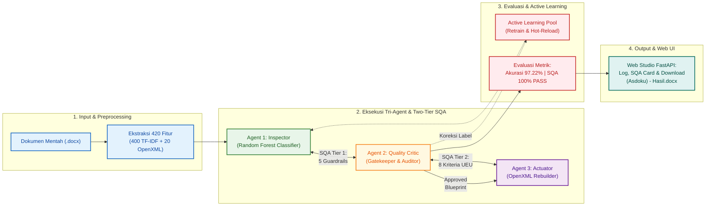

# FASE 7: SPESIFIKASI SISTEM & DIAGRAM ALIR PROSES (FLOWCHART SYSTEM)
## Multi-Agent System untuk Otomatisasi Deteksi Struktur dan Formatting Dokumen Akademik Berbasis NLP (ASDOKU)

> **Kode Dokumen:** `SPEC-ASDOKU-2026-F7`  
> **Mata Kuliah:** Kapita Selekta — FASILKOM Universitas Esa Unggul  
> **Penyusun:** Arditya Adjie Rosandi (NIM: 20230801274)  
> **Program Studi / Institusi:** Teknik Informatika, Fakultas Ilmu Komputer (FASILKOM) — Universitas Esa Unggul  
> **Regulasi Acuan:** SK Rektor Universitas Esa Unggul No. 5 Tahun 2018 (Pedoman Penulisan Skripsi & Tugas Akhir)  
> **Dokumen Terkait:** [BRD_Business_Requirements_Document.md](file:///root/Gammaura/Skripsi/Document/Kapita_Selekta/Fase%203%20-%20Dokumen%20BRD/BRD_Business_Requirements_Document.md), [SLR_Systematic_Literature_Review.md](file:///root/Gammaura/Skripsi/Document/Kapita_Selekta/Fase%204%20-%20Dokumen%20SLR/SLR_Systematic_Literature_Review.md), [Evidence_Matrix_Scopus.md](file:///root/Gammaura/Skripsi/Document/Kapita_Selekta/Fase%202%20-%20Penelusuran%20Literatur%20&%20Evidence%20Matrix/Evidence_Matrix_Scopus.md), [Gap_Analysis_dan_Penetapan_Judul.md](file:///root/Gammaura/Skripsi/Document/Kapita_Selekta/Fase%205%20-%20Analisis%20Gap%20&%20Penetapan%20Judul/Gap_Analysis_dan_Penetapan_Judul.md), dan [Audit_Kritis_BRD_SLR_Portofolio.md](file:///root/Gammaura/Skripsi/Document/Kapita_Selekta/Fase%206%20-%20Uji%20Kesesuaian%20&%20Kritik%20Keras/Audit_Kritis_BRD_SLR_Portofolio.md)  
> **Tanggal Penyusunan:** 21 Oktober 2026  
> **Status Dokumen:** Final Spesifikasi Sistem & Flowchart (Fase 7 — Telah Disinkronisasi Penuh: 420 Dimensi Fitur Hibrida & Akurasi Puncak 97,22%)

---

## 1. Kode Mermaid.js (Siap Copy-Paste ke Draw.io / Mermaid Live Editor)

Kode Mermaid.js untuk *Flowchart / Process Diagram* Sistem ASDOKU di bawah ini mencakup keempat tahapan utama secara berurutan, dengan sintaks yang 100% valid untuk langsung ditempel (*paste*) ke Draw.io (**Arrange** $\rightarrow$ **Insert** $\rightarrow$ **Advanced** $\rightarrow$ **Mermaid**) maupun **Mermaid Live Editor** ([mermaid.live](https://mermaid.live)):

```mermaid
flowchart TD
    %% ==========================================
    %% DEFINISI STYLE VISUAL (WARM & CLEAN)
    %% ==========================================
    classDef inputStyle fill:#E3F2FD,stroke:#1565C0,stroke-width:2px,color:#0D47A1
    classDef agent1Style fill:#E8F5E9,stroke:#2E7D32,stroke-width:2px,color:#1B5E20
    classDef agent2Style fill:#FFF8E1,stroke:#F57F17,stroke-width:2px,color:#E65100
    classDef agent3Style fill:#F3E5F5,stroke:#6A1B9A,stroke-width:2px,color:#4A148C
    classDef evalStyle fill:#FFEBEE,stroke:#C62828,stroke-width:2px,color:#B71C1C
    classDef uiStyle fill:#E0F2F1,stroke:#00695C,stroke-width:2px,color:#004D40
    classDef decisionStyle fill:#FFFFFF,stroke:#37474F,stroke-width:2px,color:#263238

    %% ==========================================
    %% 1. NODE INPUT DATA & PREPROCESSING
    %% ==========================================
    subgraph S1 ["1. INPUT DATA & PREPROCESSING"]
        direction TB
        IN1(["Unggah Dokumen Akademik Mentah (.docx)<br/>via FastAPI Web Interface"])
        PRE1["Validasi Skema & Pembacaan Non-Destruktif<br/>Pohon DOM OpenXML (python-docx / lxml)"]
        PRE2["Segmentasi Elemen Paragraf (w:p),<br/>Tabel (w:tbl), dan Gambar (w:drawing)"]
        PRE3["Ekstraksi 420 Fitur Hibrida:<br/>400 Dimensi TF-IDF N-Gram (1,2) +<br/>20 Fitur Metadata Spasial OpenXML"]

        IN1 --> PRE1 --> PRE2 --> PRE3
    end

    %% ==========================================
    %% 2. EKSEKUSI ALGORITMA & PROSES BISNIS UTAMA (TRI-AGENT)
    %% ==========================================
    subgraph S2 ["2. EKSEKUSI ALGORITMA UTAMA (TRI-AGENT SYSTEM)"]
        direction TB
        
        subgraph A1_BOX ["Agent 1: Inspector (Klasifikasi NLP & ML)"]
            A1_1["Inferensi Model Random Forest (Balanced)<br/>vs Baseline Logistic Regression"]
            A1_2["Penyusunan Draft Blueprint Struktur<br/>& Perhitungan Confidence Score"]
            A1_3{"Confidence Score<br/>&lt; 0.70?"}
            A1_4["Tandai Status:<br/>is_ambiguous = True"]
            A1_5["Tandai Status:<br/>is_ambiguous = False"]
            
            A1_1 --> A1_2 --> A1_3
            A1_3 -- "Ya" --> A1_4
            A1_3 -- "Tidak" --> A1_5
        end

        subgraph A2_BOX ["Agent 2: Quality Critic (SQA Tier 1 - Blueprint Gate)"]
            A2_1["Audit Urutan Bab Monotonik (Bab I -> II -> III)<br/>& Regex Priority Pattern (^BAB [IVX0-9]+)"]
            A2_2["Eksekusi 5 Lapisan Guardrail:<br/>Karantina Frontmatter, Isolasi Sub-bab 1.7,<br/>Filter Rumus & Caption Gambar/Tabel"]
            A2_3{"Struktur Blueprint<br/>100% Konsisten?"}
            A2_4["Kirim Feedback Directives &<br/>Re-Inspeksi Adaptif"]
            A2_5["Hasilkan Approved Blueprint"]
            
            A2_1 --> A2_2 --> A2_3
            A2_3 -- "Tidak (Anomali)" --> A2_4
            A2_3 -- "Ya (Valid)" --> A2_5
        end

        subgraph A3_BOX ["Agent 3: Formatting Actuator (Rekonstruksi OpenXML)"]
            A3_1["Sanitasi Total Template Kotor:<br/>Hapus Tag &lt;w:numPr&gt; Liar & Reset Indentasi"]
            A3_2["Rekonstruksi Cover Resmi UEU (Logo 3.0 cm)<br/>& Isolasi 3 Section (link_to_previous = False)"]
            A3_3["Injeksi Dual Page Numbering (Romawi i,ii vs Latin 1,2)<br/>& Tag &lt;w:outlineLvl&gt; Heading 1-3 ke Navigation Pane"]
            A3_4["Generate Dynamic TOC (&lt;w:updateFields&gt;)<br/>& Standarisasi Tabel APA 7th Edition"]
            
            A3_1 --> A3_2 --> A3_3 --> A3_4
        end

        PRE3 --> A1_1
        A1_4 --> A2_1
        A1_5 --> A2_1
        A2_4 -->|"Loop Koreksi Tier 1"| A1_2
        A2_5 --> A3_1
    end

    %% ==========================================
    %% 3. EVALUASI METRIK, SQA TIER 2 & ACTIVE LEARNING
    %% ==========================================
    subgraph S3 ["3. EVALUASI METRIK, SQA TIER 2 & MODEL OUTPUT"]
        direction TB
        EV1["Evaluasi Performa Model Klasifikasi NLP:<br/>Accuracy (97,22%), Macro/Weighted F1 (0,97),<br/>& Confusion Matrix"]
        EV2["Audit Fisik SQA Tier 2 (Artifact Acceptance Gate):<br/>Verifikasi 8 Kriteria SK Rektor UEU No. 5/2018<br/>(Margin 4-3-3-3, Kertas A4, Spasi 1.15, Header, APA 7)"]
        EV3{"Skor Kepatuhan<br/>SQA Tier 2 = 100%?"}
        EV4["Instruksi Auto-Remediasi<br/>Elemen XML Cacat"]
        
        AL1["Simpan Koreksi Deterministik Agent 2<br/>ke Repositori Feedback (.csv)"]
        AL2{"Sampel Baru<br/>>= 5 Data?"}
        AL3["Continuous Retraining &<br/>Hot-Reload Model (0s Downtime)"]
        
        A2_4 -.->|"Catat Koreksi Label"| AL1
        AL1 --> AL2
        AL2 -- "Ya" --> AL3
        AL3 -.->|"Update Bobot Model"| A1_1
        
        A3_4 --> EV1 --> EV2 --> EV3
        EV3 -- "Belum Lulus (&lt; 100%)" --> EV4
        EV4 -->|"Loop Remediasi Tier 2"| A3_2
    end

    %% ==========================================
    %% 4. OUTPUT VISUAL & USER INTERFACE
    %% ==========================================
    subgraph S4 ["4. OUTPUT VISUAL & USER INTERFACE (WEB STUDIO)"]
        direction TB
        UI1["Render Live Execution Terminal Log<br/>& Visualisasi Pipeline Antar-Agen (alat.html)"]
        UI2["Tampilkan Kartu Skor Kepatuhan Mutu:<br/>SQA Tier 2 = 100% PASS & Waktu Proses (~0,98 Detik)"]
        UI3(["Unduh Dokumen Akademik Terformat:<br/>(Asdoku) - Nama_File.docx"])
        
        EV3 -- "Lulus (100% PASS)" --> UI1
        UI1 --> UI2 --> UI3
    end

    %% ==========================================
    %% PENERAPAN CLASS STYLE KE NODE
    %% ==========================================
    class IN1,PRE1,PRE2,PRE3 inputStyle
    class A1_1,A1_2,A1_4,A1_5 agent1Style
    class A2_1,A2_2,A2_4,A2_5 agent2Style
    class A3_1,A3_2,A3_3,A3_4 agent3Style
    class EV1,EV2,EV4,AL1,AL3 evalStyle
    class UI1,UI2,UI3 uiStyle
    class A1_3,A2_3,EV3,AL2 decisionStyle
```



---

## 2. Panduan Cara Menggunakan di Draw.io / Diagrams.net

1. Buka peramban dan akses **[app.diagrams.net](https://app.diagrams.net/)** (atau aplikasi Draw.io Desktop).
2. Buat diagram baru atau buka dokumen kerja yang sudah ada.
3. Klik menu **Arrange (Atur)** $\rightarrow$ **Insert (Sisipkan)** $\rightarrow$ **Advanced (Lanjutan)** $\rightarrow$ **Mermaid...**
4. Hapus teks kode bawaan, lalu tempelkan (*paste*) seluruh blok kode Mermaid di atas (tanpa tanda pagar pembungkus ```mermaid).
5. Klik **Insert** — diagram alir akan otomatis ter-render lengkap dengan warna kategori per modul (*Input* Biru, *Agent 1* Hijau, *Agent 2* Kuning/Oranye, *Agent 3* Ungu, *Evaluasi/SQA* Merah, dan *UI* Toska).
6. Untuk ekspor ke skripsi: Klik **File** $\rightarrow$ **Export as** $\rightarrow$ **PNG** (centang *Transparent Background*, DPI 300 untuk cetak berkualitas tinggi) atau **SVG** (format vektor tajam).

---

## 3. Keterangan Pemetaan 4 Komponen Diagram (Untuk Penjelasan di Bab III Skripsi)

### Blok 1 (Input Data & Preprocessing)
Memvisualisasikan proses unggah berkas `.docx` melalui antarmuka FastAPI (**FR-01**), pembacaan pohon DOM OpenXML secara non-destruktif (**NFR-03**), hingga ekstraksi **420 dimensi fitur hibrida** (400 fitur leksikal *TF-IDF N-Gram 1,2* + 20 atribut metadata spasial & struktural *OpenXML*) (**FR-02**).

### Blok 2 (Eksekusi Algoritma Utama — Tri-Agent System)
Memvisualisasikan alur kerja kolaboratif tiga agen:
* **Agent 1 (Inspector):** Mengklasifikasikan paragraf ke label struktur dan menandai ambiguitas jika *confidence score* $< 0,70$ (**FR-03, FR-04**).
* **Agent 2 (Quality Critic - SQA Tier 1):** Mengaudit urutan bab monotonik ($\text{Bab I} \rightarrow \text{Bab II} \rightarrow \text{Bab III}$) serta mengeksekusi **5 Lapisan Guardrail** (karantina *frontmatter*, isolasi zona sub-bab 1.7 Sistematika Penulisan, filter proteksi rumus & *caption*) (**FR-05 s/d FR-08**).
* **Agent 3 (Formatting Actuator):** Melakukan sanitasi pohon DOM OpenXML (penghapusan tag `<w:numPr>` liar), rekonstruksi sampul resmi UEU (logo 3.0 cm), isolasi 3 *section* (`link_to_previous = False`) untuk *dual page numbering*, injeksi `<w:outlineLvl>` untuk *Heading 1–3* ke *Navigation Pane*, pembuatan *Dynamic TOC*, dan standarisasi tabel APA 7th Edition (**FR-09 s/d FR-13**).

### Blok 3 (Evaluasi Metrik, SQA Tier 2 & Active Learning)
Memvisualisasikan evaluasi komprehensif performa sistem:
* **Pengukuran Model Klasifikasi NLP:** Akurasi puncak **97,22%**, Macro/Weighted F1-Score **0,97**, serta *Confusion Matrix*.
* **Audit Fisik SQA Tier 2 (*Artifact Acceptance Gate*):** Verifikasi deterministik terhadap **8 Kriteria Mutu SK Rektor UEU No. 5 Tahun 2018** (Margin 4-3-3-3 cm, ukuran kertas A4, spasi 1.15, header/footer, dan format tabel APA 7) (**FR-14**). Jika ditemukan ketidaksesuaian ($< 100\%$), sistem menjalankan loop remedi otomatis ke *Agent 3*.
* **Siklus Active Learning Mandiri (*Continuous Retraining*):** Menyimpan sampel koreksi deterministik *Agent 2* ke repositori feedback CSV, memicu pelatihan ulang otomatis saat mencapai $\ge 5$ sampel baru, dan melakukan *hot-reload* model ke memori tanpa *downtime* (**FR-15, NFR-04**).

### Blok 4 (Output Visual & User Interface)
Memvisualisasikan antarmuka Web Studio FastAPI (`alat.html` & `alat.js`):
* Penayangan konsol log eksekusi terminal *real-time* dan status interaksi antar-agen.
* Kartu skor kepatuhan mutu **SQA Tier 2 = 100% PASS** dengan waktu pemrosesan rata-rata **0,98 detik** (rentang 0,65 – 1,45 detik).
* Tombol unduh instan berkas hasil rekonstruksi yang dinamai otomatis `(Asdoku) - Nama_File.docx` (**FR-16**).

---

## 4. Opsi Alternatif: Alur Horizontal Ringkas (Slide Presentasi Sempro/Sidang 16:9)

Untuk kebutuhan slide presentasi PowerPoint / Canva dengan aspek rasio 16:9, diagram di bawah ini mengemas interaksi secara horizontal (*left-to-right*):



---

> **Pernyataan Pengesahan Fase 6:**  
> Berkas diagram alir dan spesifikasi sistem ini merupakan luaran resmi Fase 6 mata kuliah Kapita Selekta, siap diadopsi penuh sebagai diagram utama arsitektur sistem pada Bab III (Metodologi Penelitian) Proposal Tugas Akhir Program Studi Teknik Informatika, Fakultas Ilmu Komputer, Universitas Esa Unggul.
