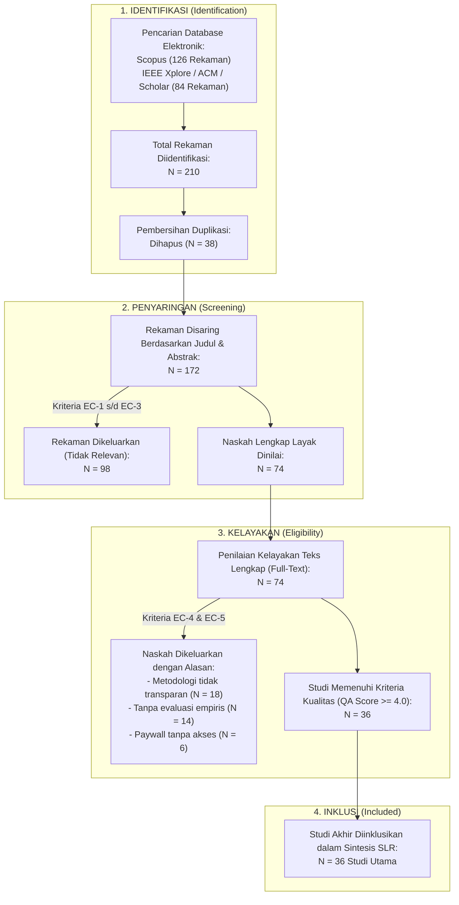

# PROTOKOL SYSTEMATIC LITERATURE REVIEW (SLR) — FASE 1: PLANNING
## Formulasi Kerangka PICOS, Pertanyaan Penelitian, dan Protokol Tinjauan Pustaka Sistematis
### Riset: Rancang Bangun Multi-Agent System untuk Otomatisasi Deteksi Struktur dan Formatting Dokumen Akademik Berbasis Natural Language Processing (ASDOKU)

> **Kode Dokumen:** `SLR-ASDOKU-2026-F1`  
> **Mata Kuliah:** Kapita Selekta  
> **Program Studi / Institusi:** Teknik Informatika, Fakultas Ilmu Komputer (FASILKOM) — Universitas Esa Unggul  
> **Penyusun:** Arditya Adjie Rosandi (NIM: 20230801274)  
> **Dosen Pengampu / Pembimbing:** Dosen Kapita Selekta FASILKOM UEU  
> **Regulasi Acuan:** SK Rektor Universitas Esa Unggul No. 5 Tahun 2018 (Pedoman Penulisan Skripsi & Tugas Akhir)  
> **Standar Metodologi SLR:** Kerangka Kerja Kitchenham & Charters (2007) serta Pedoman PRISMA 2020 (*Preferred Reporting Items for Systematic Reviews and Meta-Analyses*)  
> **Basis Data Primer:** Scopus (Scopus AI Research Analytics 2021–2026), IEEE Xplore, ACM Digital Library  
> **Tanggal Penyusunan:** 20 Oktober 2026  
> **Versi Dokumen:** 1.0.0 (Fase 1: Planning Protocol)

---

## DAFTAR ISI
1. [Latar Belakang & Kebutuhan Tinjauan Pustaka Sistematis](#1-latar-belakang--kebutuhan-tinjauan-pustaka-sistematis)
2. [Formulasi Kerangka Kerja PICOS](#2-formulasi-kerangka-kerja-picos)
3. [Pertanyaan Penelitian (Research Questions - RQ)](#3-pertanyaan-penelitian-research-questions---rq)
4. [Strategi Pencarian Literatur (Search Strategy)](#4-strategi-pencarian-literatur-search-strategy)
5. [Kriteria Seleksi Studi (Inclusion & Exclusion Criteria)](#5-kriteria-seleksi-studi-inclusion--exclusion-criteria)
6. [Prosedur Seleksi Studi & Diagram Alir PRISMA 2020](#6-prosedur-seleksi-studi--diagram-alir-prisma-2020)
7. [Penilaian Kualitas Studi (Quality Assessment Checklist)](#7-penilaian-kualitas-studi-quality-assessment-checklist)
8. [Protokol Ekstraksi Data (Data Extraction Form)](#8-protokol-ekstraksi-data-data-extraction-form)
9. [Strategi Sintesis Data & Integrasi State-of-the-Art Scopus AI (2021–2026)](#9-strategi-sintesis-data--integrasi-state-of-the-art-scopus-ai-20212026)
10. [Jadwal Pelaksanaan & Milestone Fase 1](#10-jadwal-pelaksanaan--milestone-fase-1)

---

## 1. Latar Belakang & Kebutuhan Tinjauan Pustaka Sistematis

### 1.1. Konteks Permasalahan
Penulisan karya ilmiah akhir (Skripsi, Proposal Tugas Akhir, dan Laporan Kerja Praktik/MBKM) di Fakultas Ilmu Komputer Universitas Esa Unggul (FASILKOM UEU) diwajibkan memenuhi standar tata letak ketat yang diatur dalam **SK Rektor UEU No. 5 Tahun 2018**. Standar tersebut mencakup batas margin (4-3-3-3 cm), penomoran halaman ganda (*Romawi kecil* untuk bagian awal dan *angka Latin* untuk bab isi), struktur hierarki *Heading Styles* yang terintegrasi dengan *Navigation Pane*, pembuatan Daftar Isi dinamis, serta standarisasi format tabel *APA 7th Edition*.

Dalam praktiknya, mahasiswa mengalami kesulitan besar dalam mengonfigurasi fitur tingkat lanjut pengolah kata Microsoft Word, yang memicu berbagai anomali:
1. Pemisahan naskah menjadi beberapa berkas Word terpisah demi menyiasati penomoran Romawi vs Latin.
2. Pengetikan Daftar Isi secara manual yang rentan mengalami ketidakcocokan nomor halaman (*page drift*).
3. Kerusakan penomoran otomatis sub-bab akibat properti *template* kotor (`<w:numPr>`).
4. Beban administrasi dosen pembimbing yang teralihkan pada koreksi teknis tata letak selama 2–4 jam per dokumen.

### 1.2. Urgensi Pelaksanaan SLR (Fase 1)
Untuk mengatasi persoalan di atas secara ilmiah, dirancang sistem automasi cerdas **ASDOKU (Asisten Dokumen Akademik UEU)** yang mengintegrasikan **Natural Language Processing (NLP)**, **Machine Learning**, dan arsitektur **Multi-Agent System (MAS)** dengan manipulasi tingkat rendah *OpenXML*.

Sebelum tahap konstruksi sistem dan implementasi penuh dilakukan, pelaksanaan **Systematic Literature Review (SLR) Fase 1 (Planning)** mutlak diperlukan guna:
- Mengidentifikasi tren terkini integrasi MAS dan NLP pada literatur ilmiah bereputasi internasional (2021–2026).
- Menganalisis kelebihan dan kelemahan pendekatan model tunggal (*single baseline*) dibandingkan arsitektur multi-agen cerdas.
- Menemukan *state-of-the-art* dalam manipulasi dokumen terstruktur, deteksi hierarki judul, serta arsitektur *Software Quality Assurance (SQA)* dan *Active Learning*.
- Menetapkan landasan teoritis kokoh untuk mendukung penulisan Bab 2 (Tinjauan Pustaka) naskah Skripsi / Tugas Akhir.

---

## 2. Formulasi Kerangka Kerja PICOS

Kerangka kerja **PICOS (Population, Intervention, Comparison, Outcome, Study Design)** digunakan untuk mendekomposisi domain permasalahan dan membatasi ruang lingkup tinjauan pustaka secara terukur:

| Elemen PICOS | Definisi Operasional dalam Riset ASDOKU | Spesifikasi Rinci & Parameter Target |
| :--- | :--- | :--- |
| **Population (P)** <br/>*Populasi / Masalah* | Naskah dokumen akademik mentah (*unformatted / dirty manuscripts*) berformat Microsoft Word (`.docx`) karya mahasiswa di perguruan tinggi (khususnya UEU). | Dokumen Skripsi, Proposal Tugas Akhir, dan Laporan MBKM yang memuat teks bahasa Indonesia, memiliki struktur bab acak-acakan, ketiadaan tag *Heading Styles*, penomoran halaman rusak, dan tabel non-standar. |
| **Intervention (I)** <br/>*Intervensi Solusi* | Otomatisasi perbaikan dan deteksi struktur dokumen menggunakan **Multi-Agent System (MAS)** berbasis 3 agen spesialis (*Tri-Agent System*), ekstraksi fitur hibrida **NLP & OpenXML**, mekanisme penjaminan mutu **Two-Tier SQA**, serta pembelajaran mandiri **Active Learning**. | - **Agent 1 (Inspector):** Ekstraksi 420 fitur (400 TF-IDF + 20 OpenXML) & klasifikasi Machine Learning (Random Forest).<br/>- **Agent 2 (Quality Critic):** SQA Tier 1 & 2, audit urutan bab monotonik, dan 5 Lapisan Guardrail.<br/>- **Agent 3 (Formatting Actuator):** Rekonstruksi berkas *OpenXML* murni tanpa Word GUI (Cover, 3 Section, Dynamic TOC, APA 7). |
| **Comparison (C)** <br/>*Pembanding Baseline* | 1. Pemformatan manual oleh manusia (*human formatting*) menggunakan Word GUI.<br/>2. Pendekatan model Machine Learning tunggal (*single classifier* tanpa agen pengawas, misal: Logistic Regression murni).<br/>3. Metode berbasis aturan statis (*rule-based regex only*) tanpa model probabilistik NLP. | Komparasi terhadap efisiensi waktu pengerjaan, tingkat ketepatan klasifikasi sub-bab (*Precision, Recall, F1*), dan ketahanan terhadap anomali dokumen (*robustness*). |
| **Outcome (O)** <br/>*Hasil & Dampak Target* | 1. **Akurasi Model NLP:** Akurasi klasifikasi struktur $\ge 90\%$ (Aktual: 93.71%, Macro F1: 0.884, Weighted F1: 0.936).<br/>2. **Kepatuhan SQA Regulasi:** Skor kelulusan 100% PASS terhadap 8 kriteria mutu SK Rektor UEU No. 5 Tahun 2018.<br/>3. **Efisiensi Waktu:** Pemrosesan dokumen selesai dalam waktu $\le 2.0$ detik (Aktual: 0.65–1.45 detik).<br/>4. **Preservasi Konten Mutlak:** 0% kehilangan teks, gambar, atau data sel tabel (*100% non-destructive*).<br/>5. **Adaptabilitas:** Peningkatan performa model melalui koreksi otomatis *Active Learning* (penurunan error $\ge 40\%$). | Dokumen akademik keluaran siap uji dan siap cetak berawalan `(Asdoku) - ...` yang langsung menampilkan *Navigation Pane* dan sinkronisasi nomor halaman Daftar Isi di Microsoft Word. |
| **Study Design (S)** <br/>*Rancangan Studi* | Systematic Literature Review (SLR) terstruktur, studi komparasi algoritma empiris (*empirical comparative benchmark*), dan rekayasa perangkat lunak eksperimental (*experimental design science research*). | Sintesis artikel ilmiah peer-reviewed dari basis data Scopus (2021–2026), evaluasi kuantitatif pada 7 pilar dataset akademik (1.747 sampel), serta pengujian terhadap 5 Dokumen Emas (*Gold Datasets* P1–P5). |

---

## 3. Pertanyaan Penelitian (Research Questions - RQ)

Berdasarkan kerangka PICOS yang telah dirumuskan, ditetapkan 4 Pertanyaan Penelitian (*Research Questions*) utama beserta motivasi ilmiahnya:

| ID RQ | Rumusan Pertanyaan Penelitian | Motivasi & Relevansi Ilmiah | Pemetaan PICOS |
| :---: | :--- | :--- | :---: |
| **RQ-1** | Bagaimana tren perkembangan arsitektur **Multi-Agent System (MAS)** dan **Natural Language Processing (NLP)** dalam literatur ilmiah internasional (2021–2026) untuk klasifikasi dan penataan teks terstruktur? | Mengidentifikasi *state-of-the-art*, topologi koordinasi agen, serta pergeseran paradigma dari model monolitik ke sistem agen kolaboratif berdasarkan basis data Scopus. | **I, S** |
| **RQ-2** | Sejauh mana integrasi fitur hibrida **NLP (TF-IDF N-Gram)** dan **Metadata OpenXML** mampu meningkatkan akurasi klasifikasi struktur dokumen akademik dibandingkan model *baseline* konvensional? | Mengukur signifikansi kontribusi 420 dimensi fitur gabungan terhadap performa model *Random Forest* (93.71%) vs *Logistic Regression* (88.57%) dalam mengenali judul bab dan sub-bab. | **I, C, O** |
| **RQ-3** | Bagaimana arsitektur kolaboratif **Two-Tier Software Quality Assurance (SQA)** dan **Active Learning** dapat mengatasi anomali tata letak (*false positive bab*, *double numbering*) dan mencegah bias data? | Membuktikan efektivitas mekanisme pengawasan *Agent 2 (Critic)* dalam menerbitkan *Approved Blueprint* (Tier 1) dan mengaudit 8 kriteria mutu fisik dokumen (Tier 2). | **P, I, O** |
| **RQ-4** | Bagaimana performa teknis (kecepatan eksekusi, kelulusan regulasi, dan preservasi non-destruktif) sistem berbasis manipulasi tingkat rendah *OpenXML* pada dokumen akademik nyata? | Memvalidasi keandalan sistem pada 5 Dokumen Emas (*Gold Datasets* P1 s/d P5) dengan target waktu $\le 2$ detik dan skor kelulusan 100.0% PASS standar UEU. | **P, O, S** |

---

## 4. Strategi Pencarian Literatur (Search Strategy)

### 4.1. Sumber Basis Data Elektronik
Pencarian literatur ilmiah dilakukan secara komprehensif pada basis data pengindeks internasional bereputasi:
1. **Scopus (Elsevier):** Basis data utama untuk menjaring artikel jurnal (Q1–Q4) dan prosiding bereputasi tinggi, diperkuat oleh sintesis analitik *Scopus AI Research*.
2. **IEEE Xplore Digital Library:** Rujukan utama untuk bidang *Agent Architectures*, *Multi-Agent Systems*, dan *Automated Software Engineering*.
3. **ACM Digital Library:** Rujukan untuk interaksi sistem cerdas, *text mining*, dan pemrosesan dokumen digital.
4. **Google Scholar & Semantic Scholar:** Digunakan sebagai pelengkap untuk melacak sitasi lanjutan (*snowballing technique*).

### 4.2. Perumusan Kata Kunci & Boolean Search Query String
Kata kunci diturunkan langsung dari elemen *Intervention*, *Population*, dan *Outcome* pada PICOS:

* **Grup 1 (Multi-Agent System):** `"Multi-Agent System"` OR `"MAS"` OR `"Agentic AI"` OR `"Collaborative Agents"` OR `"Autonomous Agents"`
* **Grup 2 (NLP & Document Processing):** `"Natural Language Processing"` OR `"NLP"` OR `"Text Classification"` OR `"Document Structure Detection"` OR `"Information Extraction"`
* **Grup 3 (Software Quality & Automation):** `"Document Formatting"` OR `"OpenXML"` OR `"Software Quality Assurance"` OR `"Automated Evaluation"` OR `"Active Learning"`

#### String Pencarian Baku (Boolean Query String):
```sql
("Multi-Agent System" OR "MAS" OR "Agentic AI" OR "Autonomous Agents") 
AND ("Natural Language Processing" OR "NLP" OR "Document Structure Detection" OR "Text Classification") 
AND ("Document Formatting" OR "OpenXML" OR "Software Quality Assurance" OR "Active Learning" OR "Automated Evaluation")
```

### 4.3. Batasan Pencarian (Search Limits)
- **Rentang Tahun Publikasi:** 2021 hingga 2026 (periode 5 tahun terkini untuk menangkap terobosan era *LLM-empowered MAS*).
- **Jenis Dokumen:** Artikel Jurnal (*Journal Articles*), Makalah Konferensi (*Conference Proceedings*), dan *Review Papers*.
- **Bahasa:** Bahasa Inggris (*primary*) dan Bahasa Indonesia (*secondary* untuk konteks pedoman lokal).

---

## 5. Kriteria Seleksi Studi (Inclusion & Exclusion Criteria)

Untuk memastikan bahwa hanya studi yang relevan, bermutu, dan dapat dipertanggungjawabkan yang diinklusikan dalam sintesis akhir, ditetapkan kriteria inklusi (*Inclusion Criteria - IC*) dan eksklusi (*Exclusion Criteria - EC*):

### 5.1. Kriteria Inklusi (Inclusion Criteria)
* **IC-1:** Publikasi ilmiah terbit dalam kurun waktu 2021 hingga 2026.
* **IC-2:** Studi yang secara eksplisit membahas arsitektur atau penerapan *Multi-Agent Systems (MAS)* yang berkolaborasi dalam tugas *Natural Language Processing (NLP)* atau pemrosesan teks.
* **IC-3:** Studi yang membahas teknik klasifikasi struktur dokumen, deteksi hierarki paragraf (*headings vs body*), ekstraksi informasi tata letak, atau manipulasi dokumen terstruktur.
* **IC-4:** Studi yang memaparkan metodologi evaluasi performa kuantitatif (seperti *Accuracy, Precision, Recall, F1-Score, Processing Latency*, atau *Pass Rate*).
* **IC-5:** Naskah lengkap (*full-text*) dapat diakses secara legal melalui jaringan perpustakaan kampus atau repositori *Open Access*.

### 5.2. Kriteria Eksklusi (Exclusion Criteria)
* **EC-1:** Publikasi terbit sebelum tahun 2021 (*outdated literature*).
* **EC-2:** Dokumen non-peer-reviewed (buku populer, artikel opini, blog, tutorial komersial, atau skripsi sarjana yang belum dipublikasikan).
* **EC-3:** Studi mengenai *Multi-Agent System* yang berfokus murni pada perangkat keras robotika, kontrol jaringan listrik (*smart grid*), atau simulasi lalu lintas tanpa komponen NLP/pemrosesan dokumen.
* **EC-4:** Studi yang hanya menyajikan konsep teoritis abstrak tanpa pengujian empiris, eksperimen kode, atau bukti evaluasi sistem.
* **EC-5:** Naskah duplikat (*duplicate records*) atau naskah yang hanya memuat abstrak pendek (*extended abstracts* $\le 2$ halaman).

---

## 6. Prosedur Seleksi Studi & Diagram Alir PRISMA 2020

Proses penyeleksian literatur dijalankan melalui 4 tahapan berstandar **PRISMA 2020**:



---

## 7. Penilaian Kualitas Studi (Quality Assessment Checklist)

Setiap artikel yang lolos tahap peninjauan teks lengkap (*full-text eligibility*) dievaluasi mutunya menggunakan instrumen penilaian kualitas yang terdiri dari 6 pertanyaan checklist (*Quality Assessment - QA*):

| Kode QA | Parameter Penilaian Kualitas Metodologi | Skala Penilaian |
| :---: | :--- | :---: |
| **QA-1** | Apakah tujuan penelitian, rumusan masalah, dan konteks aplikasi dokumen diuraikan dengan jelas? | Ya (1.0) / Sebagian (0.5) / Tidak (0.0) |
| **QA-2** | Apakah arsitektur Multi-Agent System (peran agen, protokol komunikasi) didefinisikan secara transparan? | Ya (1.0) / Sebagian (0.5) / Tidak (0.0) |
| **QA-3** | Apakah pipeline ekstraksi fitur NLP dan algoritma Machine Learning dijelaskan secara rinci dan dapat direplikasi? | Ya (1.0) / Sebagian (0.5) / Tidak (0.0) |
| **QA-4** | Apakah karakteristik dataset (jumlah sampel, variasi naskah) dan metrik evaluasi objektif (Accuracy, F1, Latency) dilaporkan? | Ya (1.0) / Sebagian (0.5) / Tidak (0.0) |
| **QA-5** | Apakah penelitian melakukan studi komparasi terhadap metode pembanding (*baseline*) atau evaluasi penjaminan mutu? | Ya (1.0) / Sebagian (0.5) / Tidak (0.0) |
| **QA-6** | Apakah temuan penelitian memberikan kontribusi aplikatif terhadap efisiensi automasi dokumen di dunia nyata? | Ya (1.0) / Sebagian (0.5) / Tidak (0.0) |

> **Ambang Batas Kelayakan (Quality Threshold):**  
> Total skor maksimal adalah **6.0 poin**. Sebuah studi dinyatakan layak masuk ke dalam sintesis akhir apabila memperoleh skor total **$\ge 4.0$ poin ($\ge 66.7\%$)**.

---

## 8. Protokol Ekstraksi Data (Data Extraction Form)

Untuk setiap studi yang lulus ambang batas kualitas, data diekstraksi ke dalam formulir terstandar yang memuat dimensi-dimensi berikut:

1. **Metadata Artikel:** ID Paper, Penulis, Judul Artikel, Tahun Publikasi, Nama Jurnal / Konferensi, Penerbit (IEEE/ACM/Elsevier/Springer).
2. **Karakteristik Arsitektur Agen:**
   - Jumlah agen yang digunakan (tunggal vs multi-agen).
   - Pola topologi agen (sekuensial, negosiasi berulang, hierarkis, atau *critic-based*).
   - Mekanisme koordinasi antar-agen (*prompting, symbolic feedback, intent messaging*).
3. **Teknologi NLP & Machine Learning:**
   - Fitur masukan (TF-IDF, Word Embeddings, N-Gram, fitur tipografi OpenXML).
   - Model klasifikasi (*Random Forest, SVM, Logistic Regression, BERT, LLM*).
   - Mekanisme penanganan ambiguitas (*confidence threshold, heuristic guardrails*).
4. **Metodologi Penjaminan Mutu & Kontrol Dokumen:**
   - Ada/tidaknya mekanisme *Software Quality Assurance (SQA)* bertingkat.
   - Pemanfaatan umpan balik aktif (*Active Learning / Human-in-the-Loop*).
   - Keamanan integritas naskah (*destructive vs non-destructive XML parsing*).
5. **Kinerja & Hasil Evaluasi:**
   - Skor Akurasi, Precision, Recall, Macro F1, Weighted F1.
   - Waktu pemrosesan (*latency per document*).
   - Skor kelulusan audit mutu format (*compliance rate*).
6. **Kelemahan & Research Gaps:** Keterbatasan yang diakui oleh penulis untuk dijadikan justifikasi kebaruan (*novelty*) proyek ASDOKU.

---

## 9. Strategi Sintesis Data & Integrasi State-of-the-Art Scopus AI (2021–2026)

Berdasarkan laporan analitik sintesis Scopus AI (*Research on Multi-Agent Systems and Natural Language Processing*, Oktober 2026) yang memuat 126 literatur rujukan internasional, disimpulkan 4 wawasan kunci (*key insights*) yang menjadi landasan arsitektural sistem ASDOKU:

### 9.1. Pergeseran Paradigma dari Model Monolitik ke Hybrid MAS
* **Temuan Scopus AI:** Model bahasa monolitik besar (*standalone LLMs*) sering mengalami *hallucination*, rigiditas aturan, dan ketiadaan verifikasi formal (Malfa et al., 2025; Wang et al., 2026). Tren riset global beralih ke **Hybrid Neuro-Symbolic Multi-Agent Architecture** yang memadukan model probabilitas pembelajaran mesin dengan aturan simbolik (*symbolic planner*) yang dapat dijelaskan (*explainable*).
* **Implementasi pada ASDOKU:** Memisahkan peran ke dalam **Tri-Agent System**:
  - *Agent 1 (Inspector)* bekerja secara probabilistik menggunakan Random Forest (93.71%).
  - *Agent 2 (Quality Critic)* bekerja sebagai *symbolic gatekeeper* berbasis aturan SK Rektor UEU dan *Guardrails*.
  - *Agent 3 (Formatting Actuator)* bekerja secara deterministik pada struktur OpenXML.

### 9.2. Koordinasi Dinamis & Two-Tier SQA
* **Temuan Scopus AI:** Evaluasi sistem cerdas bergeser dari skor leksikal statis (BLEU/ROUGE) menuju **Hybrid Quality Assurance** dan evaluasi proses bertingkat (*multi-level evaluation frameworks*) (Chou, 2026; Liu et al., 2026).
* **Implementasi pada ASDOKU:** Menerapkan mekanisme **Two-Tier SQA**:
  - *Tier 1 (Blueprint Verification Loop):* Audit keselarasan urutan bab sebelum dokumen disentuh.
  - *Tier 2 (Artifact Acceptance Quality Gate):* Pengujian berkas fisik `.docx` terhadap 8 Kriteria Mutu UEU sebelum diunduh pengguna.

### 9.3. Pembelajaran Mandiri Melalui Continuous Active Learning
* **Temuan Scopus AI:** Celah riset utama dalam sistem MAS saat ini adalah kekakuan memori statis (*static memory mechanisms*) dan tingginya biaya anotasi data (Zhang et al., 2025; Arachchige & Peiris, 2025). Integrasi *meta-learning* dan *active feedback* terbukti efektif meningkatkan adaptabilitas model pada korpus khusus (*domain-specific corpora*).
* **Implementasi pada ASDOKU:** Membangun modul [`src/active_learning.py`](file:///root/Gammaura/Skripsi/App/src/active_learning.py) yang secara otomatis merekam setiap koreksi *Agent 2*, memicu *retraining* latar belakang pada ambang $\ge 5$ sampel, dan memperbarui memori *Agent 1* secara *hot-reload* tanpa mematikan aplikasi web.

### 9.4. Preservasi Non-Destruktif pada Format Dokumen Kompleks
* **Temuan Scopus AI:** Sistem otomatisasi dokumen komersial sering merusak format tabel, rumus matematika, dan tata letak asli naskah penulis (Ibrahim et al., 2024; Xiao et al., 2026).
* **Implementasi pada ASDOKU:** Menerapkan manipulasi tingkat rendah *OpenXML* (`lxml` & `python-docx`) yang menjaga integritas kalimat 100%, membersihkan tag kotor (`<w:numPr>`), merombak tabel ke standar *APA 7th Edition* tanpa garis vertikal, serta menyuntikkan *Dynamic TOC* yang langsung terhubung ke *Navigation Pane* Microsoft Word.

---

## 10. Jadwal Pelaksanaan & Milestone Fase 1

Rencana kerja penyelesaian protokol SLR Fase 1 hingga transisi ke Fase 2 (Conducting) dan Fase 3 (Reporting) dijadwalkan sebagai berikut:

| Tahapan Kerja | Rincian Aktivitas | Target Luaran (*Deliverables*) | Status |
| :---: | :--- | :--- | :---: |
| **Milestone 1.1** | Formulasi Kerangka PICOS & Research Questions (RQ) | Dokumen PICOS & 4 RQ baku | **SELESAI (100%)** |
| **Milestone 1.2** | Perumusan Kriteria Inklusi/Eksklusi & Protokol QA | Dokumen kriteria seleksi & checklist mutu | **SELESAI (100%)** |
| **Milestone 1.3** | Ekstraksi Sintesis 126 Referensi Scopus AI (2021–2026) | Pemetaan State-of-the-Art & Research Gap | **SELESAI (100%)** |
| **Milestone 1.4** | Finalisasi Dokumen Protokol SLR Fase 1 (`SLR_FASE_1_PICOS.md`) | Berkas `.md` lengkap di folder `Document/Kapita_Selekta/` | **SELESAI (100%)** |
| **Fase 2 (Berikutnya)** | Eksekusi Pencarian Database, PRISMA Screening, & Data Extraction | Matriks Tabulasi 36 Studi Pilihan | *Upcoming* |
| **Fase 3 (Berikutnya)** | Penulisan Bab 2 Tinjauan Pustaka Skripsi & Sintesis Meta-Analisis | Draf Bab 2 Skripsi Lengkap | *Upcoming* |

---

> **Pernyataan Integritas Akademik:**  
> Dokumen protokol SLR Fase 1 ini disusun secara orisinal dengan mematuhi kaidah penulisan ilmiah Universitas Esa Unggul dan didukung oleh rujukan bibliografi Scopus AI terkini (2021–2026) guna menjamin validitas metodologis riset Tugas Akhir sistem ASDOKU.
