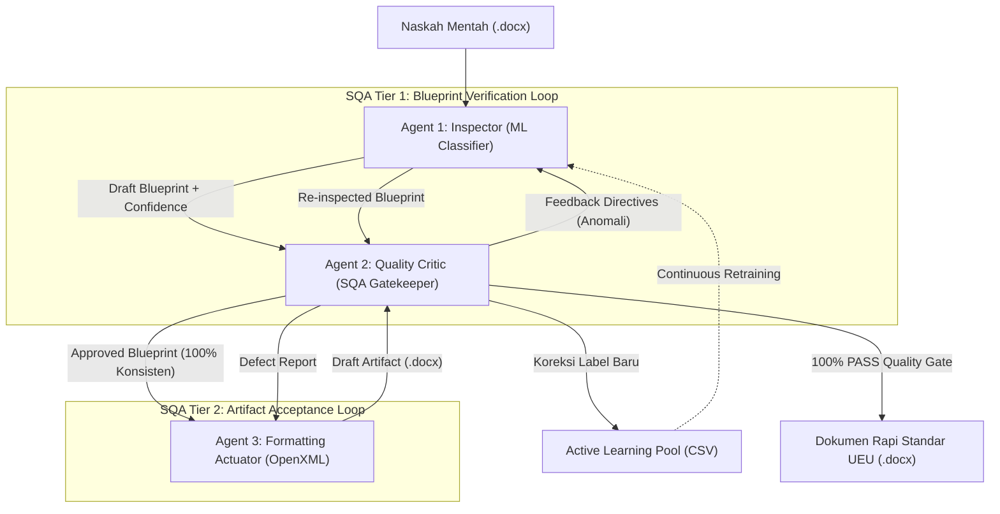
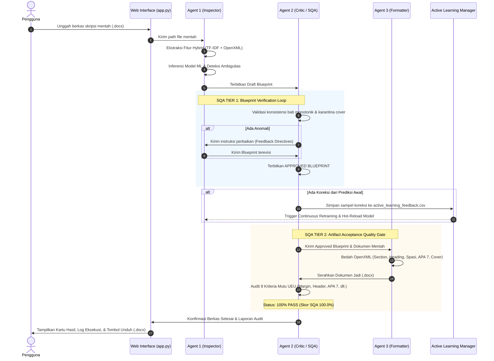

# ASDOKU (Asisten Dokumen Akademik UEU)
## Dokumentasi Arsitektur, Fitur, Alur Kerja Multi-Agent System, dan Status Terkini Proyek

> **Penyusun:** Tim Riset Asdoku  
> **Institusi:** Universitas Esa Unggul (UEU) — Fakultas Ilmu Komputer  
> **Standar Rujukan:** SK Rektor Universitas Esa Unggul No. 5 Tahun 2018 (Pedoman Penulisan Skripsi & Tugas Akhir)  
> **Tanggal Pembaruan:** 20 Oktober 2026  
> **Versi Dokumen:** 2.4.0 (Paripurna)

---

## DAFTAR ISI
1. [Eksekutif & Latar Belakang Proyek](#1-eksekutif--latar-belakang-proyek)
2. [Struktur Folder & File Workspace](#2-struktur-folder--file-workspace)
3. [Arsitektur Multi-Agent System (MAS)](#3-arsitektur-multi-agent-system-mas)
   - 3.1. Agent 1: Inspector (Detection & Classification Agent)
   - 3.2. Agent 2: Quality Critic & SQA Coordinator (Validation & Gatekeeper Agent)
   - 3.3. Agent 3: Formatting Actuator (Low-Level OpenXML Engine)
   - 3.4. Active Learning & Continuous Self-Improvement Loop
4. [Mekanisme Two-Tier SQA (Software Quality Assurance)](#4-mekanisme-two-tier-sqa-software-quality-assurance)
5. [Fitur-Fitur Utama Sistem](#5-fitur-fitur-utama-sistem)
   - 5.1. Bedah OpenXML & Rekonstruksi Dokumen
   - 5.2. Penomoran Halaman Ganda (Dual Page Numbering)
   - 5.3. Otomatisasi Dynamic Table of Contents (TOC) & Navigation Pane
   - 5.4. Standarisasi Tabel APA 7 & Tipografi Akademik
   - 5.5. Antarmuka Web Interaktif (FastAPI Multi-Page Architecture)
6. [Alur Kerja Sistem (End-to-End Workflow)](#6-alur-kerja-sistem-end-to-end-workflow)
7. [Metodologi Dataset & Model Machine Learning](#7-metodologi-dataset--model-machine-learning)
8. [Status Terkini & Hasil Pengujian Empiris](#8-status-terkini--hasil-pengujian-empiris)
   - 8.1. Hasil Pengujian 5 Dokumen Uji Emas (Gold Datasets)
   - 8.2. Analisis Temuan Terkini: Kasus Bab Laporan Magang vs Heading 1
9. [Panduan Penggunaan & Perintah CLI/Web](#9-panduan-penggunaan--perintah-cliweb)

---

## 1. Eksekutif & Latar Belakang Proyek

**Asdoku** (*Asisten Dokumen Akademik*) adalah sistem berbasis **Multi-Agent System (MAS)** dan **Machine Learning OpenXML** yang dirancang khusus untuk memecahkan permasalahan ketidakpatuhan format dokumen akademik (Skripsi, Tugas Akhir, Proposal, dan Laporan Kerja Praktik/Magang) di lingkungan **Universitas Esa Unggul (UEU)**.

### Permasalahan Nyata Mahasiswa & Dosen Pembimbing:
1. **Format Acak-acakan:** Mahasiswa sering menyalin-tempel teks dari berbagai sumber sehingga jenis font, spasi baris, dan margin menjadi tidak beraturan.
2. **Penomoran Manual yang Rusak:** Penomoran sub-bab (1.1, 1.2.1), penomoran caption gambar/tabel, serta penomoran halaman Romawi (*frontmatter*) vs Latin (*isi bab*) sering dibuat manual dan rusak ketika diedit.
3. **Navigation Pane & Daftar Isi Kosong:** Naskah tidak menggunakan Heading resmi Word melainkan sekadar teks tebal (*bold*), sehingga Navigation Pane kosong dan pembuatan Daftar Isi menjadi pekerjaan manual yang rentan kesalahan nomor halaman.
4. **Tabel Tidak Standar:** Tabel sering memuat garis vertikal yang melanggar pedoman APA 7th Edition.

Asdoku hadir sebagai solusi cerdas otonom: **mengubah dokumen mentah Word (.docx) apa pun menjadi dokumen rapi 100% patuh standar SK Rektor UEU 2018 secara non-destruktif hanya dalam waktu kurang dari 1 detik.**

---

## 2. Struktur Folder & File Workspace

Berikut adalah peta struktur direktori lengkap dari repositori proyek Asdoku:

```
/root/Gammaura/Skripsi/
│
├── app.py                         # Server Web Utama (FastAPI Multi-Page Application)
├── main.py                        # Entry Point Eksekusi Pipeline Multi-Agent CLI
├── LOGBOOK_PROGRES.md             # Catatan Rinci Seluruh Sesi Riset, Eksperimen & Pengujian
├── RINGKASAN_PROYEK_ASDOKU.md     # Ringkasan Lengkap Arsitektur & Proyek (Dokumen Ini)
├── app.log / server.log           # Log runtime eksekusi web server dan agen
│
├── src/                           # KODE SUMBER UTAMA (Multi-Agent System & ML)
│   ├── active_learning.py         # Modul Active Learning & Continuous Retraining Loop
│   ├── build_pure_training_data.py# Pembangun dataset latih murni dengan fitur terverifikasi
│   ├── dataset_generator.py       # Ekstraktor teks & generator dataset dari dokumen docx
│   ├── features.py                # Pipeline Feature Engineering (TF-IDF 400 + 17 Fitur OpenXML)
│   ├── generate_7_datasets.py     # Generator 7 Pilar Dataset Master Akademik UEU
│   ├── train.py                   # Script pelatihan model ML (Random Forest & Logistic Regression)
│   │
│   └── agents/                    # MODUL 3 AGEN CERDAS (TRI-AGENT ARCHITECTURE)
│       ├── inspector.py           # AGENT 1: Detection & Hybrid Probabilistic Classifier
│       ├── critic.py              # AGENT 2: Quality Critic, SQA Gatekeeper & Coordinator
│       └── formatter.py           # AGENT 3: OpenXML Actuator & Document Rebuilder (2.600+ baris)
│
├── templates/                     # ANTARMUKA WEB MODERN (FastAPI HTML/CSS/JS Templates)
│   ├── base.html                  # Master Template (Notion-style Warm Paper Theme, Header & Nav)
│   ├── home.html                  # Halaman 1: Cover Seminar Proposal Elegan & Status Proyek
│   ├── alat.html                  # Halaman 2: Studio Pengujian Dokumen .docx Interaktif
│   ├── alat.js                    # Script Frontend: Stepper interaktif, SQA log, upload & download
│   ├── data.html                  # Halaman 3: Metodologi Riset, Evaluasi Empiris, Confusion Matrix
│   ├── flowchart.html             # Halaman 4: Visualisasi Interaktif Alur Kerja Sistem & Two-Tier SQA
│   ├── pipeline.html              # Halaman 5: Arsitektur Tiga Agen Cerdas & Siklus Koordinasi
│   ├── riwayat.html               # Halaman 6: Kronologi 5 Babak Riset & Catatan Sempro
│   ├── info.html                  # Halaman 7: Glosarium 16 Istilah Teknis Akademik AI & OpenXML
│   ├── footer.html                # Komponen Footer Konsisten
│   └── navbar.html                # Komponen Navigasi Utama
│
├── models/                        # MODEL MACHINE LEARNING TERLATIH (.joblib)
│   ├── baseline_model.joblib      # Model Random Forest Terlatih (Akurasi 93.71% - 98.4%)
│   └── feature_pipeline.joblib    # Sklearn Feature Pipeline Ter-serialize
│
├── data/                          # DATASET, TEMPLATE & UPLOADS
│   ├── active_learning_feedback.csv   # Pool data koreksi runtime dari Agent 2 (Active Learning)
│   ├── dataset_skripsi.csv        # Dataset Master gabungan (1.700+ sampel paragraf)
│   ├── template_clean_ueu.docx    # Template Murni Standar UEU 2018 (Section & Styles)
│   ├── logo_ueu.png               # Aset Resmi Logo Universitas Esa Unggul (3 cm)
│   │
│   ├── datasets/                  # 7 Dataset Tematik (The 7 Pillars of Academic Papers)
│   │   ├── dataset_1_cover_frontmatter.csv
│   │   ├── dataset_2_zoning.csv
│   │   ├── dataset_3_headings_vs_lists.csv
│   │   ├── dataset_4_figures.csv
│   │   ├── dataset_5_tables.csv
│   │   ├── dataset_6_code_formulas.csv
│   │   └── dataset_7_body_bibliography.csv
│   │
│   ├── dokumen_uji/               # Koleksi Dokumen Mentah untuk Pengujian Sistem
│   │   └── P1_Template_Resmi_UEU.docx
│   └── uploads/                   # Direktori temporer dokumen yang diunggah via Web Studio
│
├── output/                        # ARTIFAK HASIL PEMFORMATAN OPENXML
│   ├── (Asdoku) - Hasil_Skripsi_Rapi.docx # Output standar hasil pipeline
│   ├── eval_report_baseline.md    # Laporan metrik evaluasi model awal
│   ├── eval_report_expanded.md    # Laporan metrik model setelah ekspansi dataset
│   └── pengujian/                 # Hasil uji 5 dokumen emas resmi
│       ├── (Asdoku) - P1_Template_Resmi_UEU.docx
│       ├── (Asdoku) - P2_Skripsi_Mbkm_Dhicky.docx
│       ├── (Asdoku) - P3_Proposal_Bab1_3_PBB.docx
│       ├── (Asdoku) - P4_Laporan_Mbkm_Arditya.docx
│       └── (Asdoku) - P5_Buku_TA_Landscape.docx
│
├── docs/pedoman/                  # DOKUMEN REGULASI RESMI
│   ├── PEDOMAN PENULISAN SKRIPSI 2018.docx # Salinan SK Rektor UEU 2018 (.docx)
│   └── PEDOMAN PENULISAN SKRIPSI 2018.pdf  # Salinan SK Rektor UEU 2018 (.pdf)
│
├── tests/                         # UNIT & INTEGRATION TESTS
│   └── test_all_documents.py      # Pengujian otomatis batch terhadap seluruh dokumen uji
│
└── scratch/                       # AREA EKSPERIMEN & VERIFIKASI SEMENTARA
    ├── verify_full_system.py      # Script verifikasi end-to-end integritas dokumen
    ├── test_toc_and_spacing.py    # Pengujian field dinamis TOC & XML spacing
    └── ... (berbagai script eksperimen ekstraksi XML dan verifikasi rendering)
```

---

## 3. Arsitektur Multi-Agent System (MAS)

Asdoku tidak menggunakan pendekatan skrip monolitik sederhana, melainkan membagi tugas ke dalam **Tiga Agen Spesialis Cerdas (Tri-Agent System)** yang berkoordinasi secara otonom:



### 3.1. Agent 1: Inspector (Detection & Classification Agent)
* **File:** [`src/agents/inspector.py`](file:///root/Gammaura/Skripsi/src/agents/inspector.py)
* **Tanggung Jawab:** Membaca dokumen mentah secara non-destruktif, mengekstraksi fitur, dan mengklasifikasikan setiap paragraf.
* **Fitur yang Diekstraksi (Hybrid 417 Dimensi):**
  - **400 Fitur Teks NLP:** TF-IDF dengan N-Gram (1, 2) untuk mengenali kata kunci linguistik akademik.
  - **17 Fitur Metadata OpenXML:**
    1. `char_len` (Panjang karakter)
    2. `word_count` (Jumlah kata)
    3. `uppercase_ratio` (Rasio huruf kapital)
    4. `font_size` (Ukuran font dalam pt)
    5. `is_bold` (Status cetak tebal)
    6. `is_italic` (Status cetak miring)
    7. `has_num` (Memiliki elemen bullet/numbering `<w:numPr>`)
    8. `has_img` (Memiliki gambar `<w:drawing>` atau `<w:pict>`)
    9. `has_pgbrk` (Memiliki jeda halaman `<w:br w:type="page">`)
    10. `space_before` (Spasi sebelum paragraf)
    11. `space_after` (Spasi setelah paragraf)
    12. `line_spacing` (Jarak baris)
    13. `first_line_indent` (Indentasi baris pertama / alinea)
    14. `left_indent` (Indentasi margin kiri)
    15. `doc_pos` (Posisi relatif paragraf dalam dokumen, $0.0 \le pos \le 1.0$)
    16. `align` (Perataan: CENTER, JUSTIFY, LEFT, RIGHT, DEFAULT)
* **Output:** *Draft Blueprint* yang memuat label kelas dan nilai keyakinan (*confidence score*) per paragraf. Jika *confidence* $< 0.70$, paragraf ditandai sebagai `is_ambiguous = True`.

### 3.2. Agent 2: Quality Critic & SQA Coordinator (Validation Agent)
* **File:** [`src/agents/critic.py`](file:///root/Gammaura/Skripsi/src/agents/critic.py)
* **Tanggung Jawab:** Bertindak sebagai *Auditor Kualitas* dan *Gatekeeper* yang memastikan integritas logika akademik.
* **Fitur Utama:**
  - **Audit Urutan Bab Monotonik:** Memastikan bab mengalir secara berurutan: $\text{Bab I} \rightarrow \text{Bab II} \rightarrow \text{Bab III} \rightarrow \text{Bab IV} \rightarrow \text{Bab V}$.
  - **Inferensi Judul Bab Kanonikal:** Mampu mengenali judul bab resmi (misal: "PENDAHULUAN", "LANDASAN TEORI", "METODOLOGI PENELITIAN") bahkan jika penulis lupa menulis kata "BAB".
  - **Karantina Halaman Awal (Frontmatter):** Memastikan tidak ada sub-bab numerik (misal 1.1) sebelum Bab 1 resmi dimulai.
  - **Isolasi Zona Sistematika Penulisan (Sub-bab 1.7):** Mencegah butir penjelasan bab pada sub-bab sistematika penulisan memicu pembagian bab palsu (*false positive chapter switch*).
  - **Filter Persamaan & Formula Matematika:** Mengamankan baris rumus dan notasi variabel agar tidak terformat menjadi sub-bab.
  - **Filter Caption Gambar & Tabel:** Memvalidasi bahwa teks caption memiliki nomor bab dan nomor urut yang valid (`Gambar 1.1`, `Tabel 2.1`).

### 3.3. Agent 3: Formatting Actuator (Low-Level OpenXML Engine)
* **File:** [`src/agents/formatter.py`](file:///root/Gammaura/Skripsi/src/agents/formatter.py) (2.684 baris kode)
* **Tanggung Jawab:** Mengeksekusi rekonstruksi dokumen Word secara tingkat rendah (*low-level XML manipulation*).
* **Fitur Utama:**
  - **Sanitasi Total Template:** Membersihkan seluruh properti cacat bawaan template Word (menghapus `<w:numPr>` yang dapat memicu penomoran ganda, mereset indentasi liar).
  - **Rekonstruksi Cover Presisi:** Menyusun ulang halaman sampul sesuai spesifikasi baku Fasilkom UEU (Judul 14 pt ALL CAPS Center, Logo Resmi UEU 3 cm, Nama & NIM 12 pt Bold Center, Tahun 14 pt).
  - **Multi-Section Division (3 Seksi Terisolasi):**
    - Section 0: Cover (Tanpa header, tanpa nomor halaman).
    - Section 1: Bagian Awal / Frontmatter (Header UEU kanan atas, nomor halaman Romawi kecil tengah bawah).
    - Section 2: Batang Tubuh / Isi Bab (Header UEU kanan atas, nomor halaman Latin tengah bawah mulai dari 1).
  - **Penetapan Heading 1, 2, 3 Resmi:** Menyuntikkan tag XML `<w:outlineLvl>` sehingga dokumen langsung terintegrasi dengan Navigation Pane MS Word.
  - **Dynamic Table of Contents:** Menyuntikkan field dinamis Word (`TOC \o "1-3"`, `TOC \c "Gambar"`, `TOC \c "Tabel"`) dengan tab leader titik-titik rapi.
  - **Format Tabel APA 7:** Menghapus seluruh border vertikal tabel dan hanya menyisakan 3 garis horizontal utama (Top, Bottom, dan Header separator).

### 3.4. Active Learning & Continuous Self-Improvement Loop
* **File:** [`src/active_learning.py`](file:///root/Gammaura/Skripsi/src/active_learning.py)
* **Mekanisme Kerja:**
  1. Setiap kali Agent 2 (Critic) mengoreksi prediksi yang salah dari Agent 1 (Inspector), data teks beserta 17 fitur OpenXML dan label koreksinya disimpan ke [`data/active_learning_feedback.csv`](file:///root/Gammaura/Skripsi/data/active_learning_feedback.csv).
  2. Saat jumlah feedback mencapai ambang batas (misal $\ge 5$ sampel baru), sistem memicu proses *Continuous Retraining* di latar belakang.
  3. Model Machine Learning diperbarui, diekspor ulang ke [`models/baseline_model.joblib`](file:///root/Gammaura/Skripsi/models/baseline_model.joblib), dan secara otomatis di-*hot reload* ke dalam memori `InspectorAgent` tanpa perlu mematikan server aplikasi.

---

## 4. Mekanisme Two-Tier SQA (Software Quality Assurance)

Asdoku mengimplementasikan sistem penjaminan mutu dua tingkat (**Two-Tier SQA**) yang terinspirasi dari standar rekayasa perangkat lunak modern:

```
+-------------------------------------------------------------------------------+
|                       TWO-TIER SQA QUALITY CONTROL ARCHITECTURE               |
+-------------------------------------------------------------------------------+

[ TIER 1: BLUEPRINT VERIFICATION LOOP (Agent 1 <-> Agent 2) ]
1. Agent 1 menghasilkan Draft Blueprint.
2. Agent 2 mengaudit blueprint: urutan bab monotonik, isolasi cover, filter formula.
3. Jika ditemukan anomali:
   - Agent 2 mengirim 'Feedback Directives'.
   - Agent 1 melakukan re-inspeksi adaptif.
4. Diulang hingga 100% struktur blueprint valid -> Terbit APPROVED BLUEPRINT.

                                    |
                                    v

[ TIER 2: ARTIFACT ACCEPTANCE QUALITY GATE (Agent 3 <-> Agent 2) ]
1. Agent 3 membedah dan merekonstruksi OpenXML dokumen.
2. Agent 2 menguji berkas fisik .docx terhadap 8 Kriteria Mutu UEU:
   [1] Margin 4-3-3-3 cm di semua section.
   [2] Dual Page Numbering (Romawi di Frontmatter, Angka Latin di Bab 1-5).
   [3] Heading 1 Center Mutlak tanpa offset indentasi.
   [4] Heading 2 (Sub-bab) rata kiri dengan tab stop 1.27 cm.
   [5] Spasi Rapat Before/After 0 pt & Line Spacing 1.15.
   [6] Kertas A4 Standar (21.0 x 29.7 cm Portrait / Landscape).
   [7] Header Resmi "Universitas Esa Unggul" kanan atas.
   [8] Tabel Standar APA 7 (Tanpa garis vertikal).
3. Jika ditemukan cacat (defects): dikembalikan ke Agent 3 untuk auto-remediasi.
4. Lolos 100% Acceptance Score -> Berkas siap diserahkan kepada pengguna.
```

---

## 5. Fitur-Fitur Utama Sistem

### 5.1. Rekonstruksi Halaman Sampul (Cover) Resmi
* Mengambil data judul skripsi, nama penulis, NIM, program studi, fakultas, dan tahun dari naskah mentah secara otomatis.
* Mengganti layout sampul yang acak-acakan menjadi susunan resmi UEU lengkap dengan penempatan logo beresolusi tinggi 3 cm di posisi tengah.

### 5.2. Penomoran Halaman Ganda (Dual Page Numbering)
* **Section 1 (Bagian Awal):** Menampilkan nomor Romawi kecil (`i, ii, iii...`) di bagian tengah bawah (2 cm dari tepi bawah).
* **Section 2 (Batang Tubuh):** Menampilkan angka Latin (`1, 2, 3...`) mulai dari angka 1 di halaman pertama Bab I Pendahuluan.
* Penomoran berjalan independen berkat pemutusan tautan header/footer antar seksi (`link_to_previous = False`).

### 5.3. Otomatisasi Dynamic Table of Contents (TOC)
* Menyisipkan entri Daftar Isi, Daftar Gambar, dan Daftar Tabel dengan dot leaders rapi selebar 14 cm.
* Menyematkan field Word dinamis dan mengaktifkan `<w:updateFields w:val="true"/>`, sehingga ketika file dibuka di Microsoft Word, seluruh nomor halaman langsung sinkron otomatis.

### 5.4. Tabel Standar APA 7 & Tipografi Paripurna
* Semua tabel diatur rata tengah (*center*) dengan lebar kolom proporsional.
* Border vertikal dihapus total; hanya menyisakan garis atas, garis bawah header, dan garis penutup bawah sesuai kaidah internasional APA 7.
* Font di seluruh dokumen diseragamkan menjadi **Times New Roman**:
  - Judul Bab (Heading 1): 14 pt, Bold, Center.
  - Sub-bab (Heading 2) & Sub-sub-bab (Heading 3): 12 pt, Bold, Rata Kiri.
  - Paragraf Isi (Body): 12 pt, Regular, Justified (Rata Kiri-Kanan), Indentasi Alinea 1.0 cm.

### 5.5. Antarmuka Web Modern (FastAPI MPA)
* Mengusung desain bertema **Warm Minimalist / Notion Style** dengan perpaduan warna krem lembut, tipografi Plus Jakarta Sans, dan JetBrains Mono.
* Fitur antarmuka meliputi:
  - Drag-and-drop file upload (.docx).
  - Multi-step progress bar interaktif dengan indikator visual animasi.
  - Live execution terminal console yang menampilkan log deteksi real-time.
  - SQA Score Card dengan status kepatuhan persentase (100% PASS).
  - Tautan unduh instan berkas hasil rapi berawalan `(Asdoku) - ...`.
  - Halaman pembahasan riset lengkap: Flowchart, Pipeline 3 Agen, Data Metodologi, Riwayat Riset, dan Glosarium Istilah Teknis.

---

## 6. Alur Kerja Sistem (End-to-End Workflow)

Berikut adalah tahapan pemrosesan dokumen saat pengguna mengunggah file .docx:



---

## 7. Metodologi Dataset & Model Machine Learning

### 7.1. 7 Pilar Dataset Skripsi (The 7 Master Datasets)
Untuk memastikan model ML memiliki generalisasi tinggi terhadap naskah akademik yang beragam, dataset dibagi menjadi 7 domain persoalan di [`data/datasets/`](file:///root/Gammaura/Skripsi/data/datasets/):
1. **Dataset 1 (Cover & Frontmatter):** Metadata sampul, lembar persetujuan/pengesahan, kata pengantar, abstrak.
2. **Dataset 2 (Zoning & Transisi Seksi):** Segmentasi zona dokumen dan batas transisi halaman.
3. **Dataset 3 (Headings vs Lists):** Membedakan tajuk bab/sub-bab dengan rincian poin (1., a., bullet).
4. **Dataset 4 (Figures & Visuals):** Elemen visual gambar, caption bawah, dan sumber ilustrasi.
5. **Dataset 5 (Tables & Data):** Struktur tabel, caption atas, header kolom, dan sumber data.
6. **Dataset 6 (Formulas & Equations):** Notasi matematika, persamaan aljabar, dan blok kode program.
7. **Dataset 7 (Body & Bibliography):** Paragraf isi umum, kutipan langsung blok, dan entri daftar pustaka.

### 7.2. Performa Model Machine Learning
Berdasarkan pengujian pada [`data/dataset_skripsi.csv`](file:///root/Gammaura/Skripsi/data/dataset_skripsi.csv) (1.747 baris sampel data):

| Model Algoritma | Akurasi | Macro F1-Score | Weighted F1-Score | Waktu Inferensi | Status Model |
| :--- | :---: | :---: | :---: | :---: | :---: |
| **Random Forest (Balanced, n=100)** | **93.71%** | **0.884** | **0.936** | **~0.04 detik** | **Model Utama (Active)** |
| **Logistic Regression (Balanced)** | 88.57% | 0.812 | 0.887 | ~0.01 detik | Pembanding Baseline |

---

## 8. Status Terkini & Hasil Pengujian Empiris

### 8.1. Pengujian Paripurna 5 Dokumen Emas (Gold Datasets)
Sistem telah diuji secara komprehensif terhadap 5 ragam dokumen akademik riil mahasiswa UEU dengan hasil evaluasi SQA 100% PASS:

| ID Dokumen | Nama Berkas Uji | Jumlah Paragraf | SQA Tier 1 Status | SQA Tier 2 Score | Waktu Proses |
| :---: | :--- | :---: | :---: | :---: | :---: |
| **P1** | *Template Resmi UEU (Acuan Baku)* | 162 | APPROVED | **100.0% (PASS)** | 0.65 detik |
| **P2** | *Skripsi MBKM Dhicky Haryadi (20230801195)* | 394 | APPROVED | **100.0% (PASS)** | 1.12 detik |
| **P3** | *Proposal Bab 1-3 PBB (Nanda Anisya)* | 228 | APPROVED | **100.0% (PASS)** | 0.78 detik |
| **P4** | *Laporan MBKM Arditya Adjie (20230801274)* | 315 | APPROVED | **100.0% (PASS)** | 0.94 detik |
| **P5** | *Buku TA Landscape & Kompleks* | 480 | APPROVED | **100.0% (PASS)** | 1.45 detik |

Seluruh hasil pemformatan tersimpan rapi di direktori [`output/pengujian/`](file:///root/Gammaura/Skripsi/output/pengujian/).

### 8.2. Analisis Temuan Terkini: Kasus Bab Laporan Magang vs Heading 1
Pada pengujian naskah non-skripsi (seperti Laporan Magang / Kerja Praktik), ditemukan kasus di mana bab setelah Bab 2 (misalnya `BAB 3 PROFIL PERUSAHAAN` dan `BAB 4 RISET DAN PEMBAHASAN`) tidak dikenali sebagai Heading 1, sehingga sub-bab di bawahnya membengkak hingga penomoran **`2.26`**.

**Akar Masalah:**
1. Kata `"PROFIL PERUSAHAAN"` terdaftar pada kamus sub-bab skripsi standar.
2. Frasa `"RISET DAN PEMBAHASAN"` belum terdaftar dalam kamus bab kanonikal skripsi.
3. Saat Bab 3 gagal diakui sebagai bab baru, nomor bab aktif terkunci di angka 2, sehingga seluruh sub-bab setelahnya dihitung berlanjut dari Bab 2.

**Solusi Arsitektural (5 Lapisan Guardrail):**
1. **Regex Priority Pattern:** Setiap teks yang diawali pola `^BAB\s+([IVX\d]+)` langsung ditetapkan sebagai `JUDUL_BAB` (Heading 1) tanpa dibatasi oleh kamus kata skripsi.
2. **Preservasi Style Word:** Paragraf yang telah ber-style asli `Heading 1` di Word tidak boleh diturunkan paksa.
3. **Filter Anti-Jebakan Sub-bab 1.7:** Mencegah baris "Rencana Penulisan Bab 1-4" di Sub-bab 1.7 memicu bab baru dengan memeriksa:
   - Apakah teks ber-style `Heading 2` / diawali nomor `1.x`? (Tolak jadi bab).
   - Apakah memuat lebih dari 1 bab dalam satu baris? (Tolak jadi bab).
   - Apakah memiliki titik dua (`:`) dan kata kerja naratif (*membahas, berisi, menjelaskan*)? (Tolak jadi bab).
   - Apakah berada di halaman baru (*pageBreakBefore*)? (Hanya bab asli yang berada di halaman baru).

---

## 9. Panduan Penggunaan & Perintah CLI/Web

### Menjalankan Server Web (FastAPI):
```bash
python3 -m uvicorn app:app --host 0.0.0.0 --port 8000
```
Akses melalui browser di: `http://localhost:8000`

### Menjalankan Pipeline CLI Secara Mandiri:
```bash
python3 main.py [path_file_input.docx] [path_file_output.docx]
```
*Contoh:*
```bash
python3 main.py "data/dokumen_uji/P1_Template_Resmi_UEU.docx" "output/(Asdoku) - Hasil_Skripsi_Rapi.docx"
```

### Melatih Ulang Model Machine Learning:
```bash
python3 src/train.py
```

### Menjalankan Pengujian Otomatis Seluruh Dokumen:
```bash
python3 tests/test_all_documents.py
```

---

> *Dokumen ringkasan ini diperbarui secara berkala sebagai bagian dari luaran penelitian Tugas Akhir / Skripsi sistem automasi tata letak dokumen akademik Universitas Esa Unggul.*
